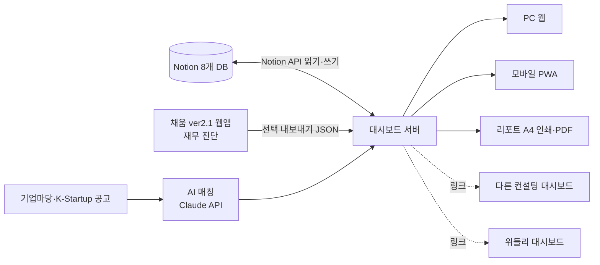

# 채움기업컨설팅관리대시보드 — 기획서 v1.1

- 작성일: 2026-10-30 · 상태: 초안(검토용)
- 원본(노션): 채움파트너스 › 채움기업컨설팅관리대시보드 › 기획서 v1 — https://app.notion.com/p/40979506f3a38113926dc13d127a5d16
- 이 문서는 개발용 사본입니다. 노션 기획서와 내용이 다르면 **노션이 기준**이고, 이 문서는 개발에 필요한 ID·연동 규격을 더 담습니다.

---

## 1. 한 줄 정의

채움파트너스가 관리하는 고객사의 **기본정보 · 진행업무 · 접촉이력 · 보유인증 · 기업보험 · 연도별 재무 · 차년도 목표**를 한 화면에서 보고,
**언제든 인쇄 가능한 리포트 2종**으로 대표님께 제공하는 1인 컨설턴트용 대시보드. 노션이 원본 데이터이고, 대시보드는 노션을 읽고 쓰는 화면입니다.

## 2. 1인 사업자 관점의 목표 (자동화 포인트)

| 지금 손으로 하는 일 | 대시보드가 대신하는 일 |
|---|---|
| 업체별 노션 페이지를 뒤져 최근 연락일 확인 | 접촉이력 1줄 입력 → 업체의 최근 접촉일·방법 자동 갱신, 30일 미접촉 경고 |
| 대표님 미팅 전 자료 취합 | 업체 상세 1화면 + 종합솔루션 리포트 원클릭 인쇄 |
| 지원사업 공고 직접 검색 | 기업 프로필 기반 AI 매칭 → 검토 후 제안 |
| 보험 만기·인증 만료·공고 마감 기억 | 통합 캘린더 + (P4) 카카오/메일 알림 |
| 노션에 정리한 메모를 표로 다시 옮기기 | Claude가 노션 메모를 읽어 연관 DB에 구조화 기입 |
| 연말 차년도 계획서 작성 | 대표님 목표 → 분기별 과업 → 차년도 실행 리포트 자동 구성 |

## 3. 요구사항 (요청 원문 기준)

1. **업체 마스터**: 사업자등록증(파일), 사업자·법인등록번호, 대표자, 회사전화, 대표 휴대폰, 기업형태·업종·지역·설립일·근로자·매출
2. **진행업무**: 현재 어떤 업무를 진행 중인지 + 관리상태(잠재 → 상담중 → 계약·진행 → 사후관리 → 종료)
3. **접촉이력**: 문자·전화·방문(+이메일·화상)을 언제 했는지 타임라인, 최근 방문일
4. **대표 관심사** → **내가 제공할 솔루션** → **AI 지원사업 매칭**
5. **기적용 솔루션**: 벤처인증, 기업부설연구소, 특허, 이노비즈, 메인비즈, 각종 인증, 스마트팩토리, 정부지원금 (채움 수행 / 기존 보유 구분)
6. **기업보험**: 상품명, 보험사, 금액(보험료·보장금액), 계약기간, 만기
7. **연도별 재무컨설팅**: 기존 기업컨설팅 웹앱에서 **선택한 업체만** 가져와 연도별 정리
8. **리포트 + 인쇄**: ① 종합솔루션 진행 리포트 ② 차년도 목표 기반 실행 리포트 — 항상 A4 인쇄·PDF
9. **관리자 페이지**: 업체 추가·수정·삭제 → 노션 자동 반영
10. **어디서나**: PC 웹 · 모바일 · 사무실 안/밖
11. **연계 대시보드 메뉴**: 다른 기업컨설팅대시보드, 위들리 대시보드로 이동 (데이터 공유 없음, 링크/임베드만)

## 4. 시스템 구조

- **노션 = 원본(Source of Truth)**. 업체 수백 개 규모라 별도 DB 없이 운영, 서버에서 1~5분 캐시 + ‘새로고침’ 버튼.
- 대시보드에서 추가·수정 → 즉시 Notion API로 기록. 삭제 → 노션 휴지통(복구 가능).
- 외부 접속은 관리자 로그인 필수(휴대폰·재무정보 보호). API 키는 서버 환경변수에만.

## 5. 노션 데이터 구조 (구축 완료)

위치: 채움파트너스(📁) › 채움기업컨설팅관리대시보드(🧭) — https://app.notion.com/p/40979506f3a38177b4d1f7f44081f09b

| DB | 역할 | data source ID |
|---|---|---|
| 기업컨설팅관리대시보드 | 업체 마스터 (1기업 1행) | `5114ba2d-9f79-4bee-9d6f-40f809aea52d` |
| 접촉이력 (문자·전화·방문) | 활동 타임라인 | `48a833b1-1c91-4f40-a359-fbc7c17a89cd` |
| 인증·솔루션 적용현황 | 기적용 솔루션 | `e7b5c9bc-594a-4437-9ecf-fd5c2b947396` |
| 기업보험 계약현황 | 보험 | `846c6d05-afd7-4f07-b426-57ef979a104a` |
| 연도별 재무컨설팅 | 재무 추이 | `e6fb576f-9db5-41fe-8009-0d5c2fce03f4` |
| 목표·과업 (차년도 로드맵) | 내년 실행계획 | `6ebbe9ba-34d9-4379-8bd2-99b234a162f9` |
| 지원사업 AI 매칭 | AI 추천 | `9de8f780-e820-4ce4-90e5-934630c1b707` |
| 연계 대시보드 링크 | 외부 대시보드 메뉴 설정 | `c9f6d52c-e961-4c17-8f67-19201f64cec1` |

### 업체 마스터 주요 필드

| 구분 | 필드 |
|---|---|
| 식별 | 기업명(제목), 고객번호(자동), 사업자등록번호, 법인등록번호, 사업자등록증(파일), 웹앱 기업ID, 데이터출처 |
| 연락 | 대표자, 대표 휴대폰, 회사 전화, 이메일, 주소, 지역 |
| 기업 | 기업형태(법인/개인), 업종, 설립일, 상시근로자수, 최근매출(원) |
| 관리 | 관리상태, 우선순위(A/B/C), 담당자, 진행업무(다중), 다음 액션·다음 액션일 |
| 컨설팅 | 대표 관심사(다중) + 메모, 제공 예정 솔루션, 내년 목표, 재무데이터 연동(체크) |
| 접촉 | 최근 접촉일, 최근 접촉방법 (접촉이력 추가 시 자동 갱신) |
| 연결 | 접촉이력 · 인증·솔루션 · 기업보험 · 재무컨설팅 · 목표·과업 · 지원사업 매칭 (모두 양방향 관계) |

### 노션 입력 규칙

- 새 업체 = 업체 마스터에 1행. **사업자등록번호로 중복 확인**.
- 문자·전화·방문을 하면 접촉이력에 1행 → 대시보드가 마스터의 최근 접촉일·방법 갱신.
- 인증·지원금은 검토 단계부터 기록하고 상태만 바꿈.
- 주민등록번호·신분증 번호 등 민감정보는 기재하지 않음.
- 자유 메모로 정리해 두면 Claude에게 “○○기업 노션 정리해줘” → 해당 DB에 구조화해 기입 (지금도 가능한 운영 방식).

## 6. 화면 구성 (IA)

| 메뉴 | 화면 | 주요 내용 |
|---|---|---|
| 홈 | 오늘의 대시보드 | KPI(관리업체·진행중·이번달 접촉·만기임박 보험·마감임박 공고), 오늘/이번주 할 일, 30일 미접촉 경고, 최근 활동 |
| 업체 | 목록 | 검색, 필터(상태·지역·업무·우선순위), 카드/표 전환, 모바일 전화·문자 원탭 |
| 업체 | 상세 | 탭: 개요 / 접촉타임라인 / 인증·솔루션 / 보험 / 재무(연도별 차트) / 목표·과업 / AI매칭, ‘접촉 기록’ 빠른입력 |
| 리포트 | 종합솔루션 리포트 | 기업개요 → 연도별 재무추이 → 채움 수행 솔루션 → 보유 인증 → 보험 보장현황 → 활동 요약 |
| 리포트 | 차년도 실행 리포트 | 대표님 목표 → 분기별 과업 로드맵 → 추천 지원사업 → 예상효과 |
| 리포트 | (추가) 접촉 활동 리포트 | 기간별 문자·전화·방문 집계, 업체별 마지막 접촉 |
| 일정 | 캘린더 | 다음 액션·후속기한·보험 만기·인증 만료·공고 마감 통합 |
| AI 매칭 | 지원사업 매칭 | 기업 선택 → 매칭 실행 → 검토·제외·대표제안 |
| 연계 대시보드 | 바로가기 | 다른 기업컨설팅대시보드, 위들리 대시보드 (새 탭/임베드) |
| 관리자 | 업체 관리 | 추가·수정·삭제, 웹앱 업체 가져오기(체크 선택), 동기화 상태, 연계 링크 설정 |

### UX 원칙

- **모바일 우선**: 하단 탭바(홈·업체·일정·리포트·더보기), 방문 직후 ‘3초 접촉기록’(방법 선택 + 한 줄 메모).
- **PC**: 좌측 사이드바 + 목록/상세 분할.
- 채움파트너스 톤(화이트·블루/네이비), 다크모드. 기존 웹앱(`theme.css`)과 같은 색 체계를 써서 두 앱이 한 브랜드로 보이게.
- 리포트는 화면 = 인쇄물(A4 인쇄 CSS), 표지에 로고·담당 컨설턴트·기준일. 다크모드여도 인쇄는 항상 흰 배경.

## 7. 핵심 기능 상세

### 7-1. 노션 양방향 연동
- 읽기: 8개 DB 조회 → 서버 캐시, ‘새로고침’으로 즉시 동기화.
- 쓰기: 추가·수정 → 페이지 생성/업데이트. 삭제 → 휴지통.
- 접촉이력 추가 시 마스터의 최근 접촉일·방법 갱신.

### 7-2. 기업컨설팅 웹앱(채움 ver2.1) 연동 — 이번에 구조 확인

같은 레포의 `claude/corporate-consulting-web-app-mrd4c1` 브랜치에서 확인한 사실:

| 항목 | 현재 상태 | 대시보드 연동에 주는 의미 |
|---|---|---|
| 기술 | Vite + React + TypeScript, 서버 없음 | API 호출 대상이 없음 |
| 저장 | 브라우저 `localStorage`(`brief.v1`) | 대시보드가 직접 읽을 수 없음 |
| 내보내기 | `exportBackup()` → JSON `{app:'chaeum', version:1, advisor, cases[]}` | **이 JSON이 1차 연동 통로** |
| 업체 식별 | `CaseFile.id`, `company.name`, `company.ceo` | 사업자등록번호 필드가 **없음** |
| 재무 | `statements`(당기·전기 BS/IS), `history[]`(연도별 스냅샷) | 연도별 재무컨설팅 DB로 매핑 가능 |
| 상담 | `crm.stage`, `nextDate`, `nextAction`, `memos[]` | 다음 액션·접촉이력 초기값으로 활용 가능 |

**연동 방식 (단계별)**

1. **P3-a (바로 가능)**: 웹앱에서 백업 JSON 내보내기 → 대시보드 관리자 화면에 업로드 → 업체 목록이 체크박스로 표시 → **선택한 업체만** 노션에 등록.
   - 매칭 키: `웹앱 기업ID`(= `CaseFile.id`) 우선, 없으면 기업명+대표자로 후보 제시 후 사람이 확인.
   - 가져오는 값: 기업명, 대표자, 업종, 기업형태 → 마스터 / `history[]`·`statements` → 연도별 재무컨설팅(매출·영업이익·순이익·자산·부채·차입금·부채비율, 진단등급).
   - 마스터의 `데이터출처 = 컨설팅웹앱`, `재무데이터 연동 = ✓`.
2. **웹앱 쪽 보완(작은 수정)**: `CompanyProfile`에 사업자등록번호·대표 휴대폰·회사 전화 필드 추가 → 중복 확인을 사업자등록번호로 확정.
3. **P3-b (웹앱 서버 저장 이후)**: 웹앱이 계획대로 Supabase로 옮겨가면 JSON 업로드 대신 API로 직접 조회.

### 7-3. AI 지원사업 매칭
- 공고 수집: 기업마당(bizinfo) 공고 API, K-Startup 등 주기 수집.
- 매칭: 기업 프로필(업종·지역·업력·규모·보유인증·관심사·내년 목표) vs 공고 자격요건 → Claude가 적합도(0~100)·근거 생성.
- 결과는 ‘AI추천’ 상태로만 저장, **컨설턴트 검토 후에만 대표님께 제안**.

### 7-4. 리포트 & 인쇄
- 브라우저 인쇄(Ctrl+P) A4 최적화 → PDF 저장. 필요 시 리포트를 노션 페이지로 보관.
- 리포트 문장(요약·제언)은 Claude가 초안 → 컨설턴트가 수정 후 출력.

### 7-5. 관리자 & 보안
- 관리자 비밀번호 로그인(1인), 향후 팀원 조회/편집 권한 분리.
- 삭제는 휴지통 이동(영구삭제 없음), 변경 이력은 노션 버전 기록.

## 8. 기술 스택 (제안)

| 영역 | 선택 | 이유 |
|---|---|---|
| 프론트·서버 | Next.js + TypeScript | PC·모바일 한 코드, 서버에서 Notion·Claude 키 보호 (웹앱이 서버 없는 Vite라 대시보드는 서버 필요) |
| 모바일 | PWA | 앱스토어 없이 홈화면 설치 |
| 데이터 | Notion API | 이미 노션 운영 중, 추가 DB 비용 없음 |
| AI | Claude API | 지원사업 매칭·리포트 문장 |
| 배포 | Vercel | 저비용, HTTPS·도메인 연결 쉬움 |

## 9. 단계별 개발 계획

| 단계 | 범위 | 상태 |
|---|---|---|
| P0 기획·노션 설계 | 기획서, 8개 DB, 예시 업체, 뷰 | ✅ 완료 (2026-10-30) |
| P1 대시보드 MVP | 홈·업체목록·상세·접촉기록·관리자 CRUD·로그인·모바일·연계 대시보드 메뉴 | 🟡 코드 완료·데모 검증 (2026-10-30) — 노션 토큰 연결·Vercel 배포 남음 |
| P2 리포트·인쇄 | 종합솔루션 / 차년도 실행 / 접촉 활동 리포트, 일정 캘린더 | ⬜ |
| P3 외부 연동 | 웹앱 JSON 선택 가져오기(P3-a), AI 지원사업 매칭 | ⬜ |
| P4 고도화 | 만기·마감·미접촉 알림, 기업마스터·위들리 데이터 이관, 팀원 권한 | ⬜ |

> 메모: P1은 이 레포에서 새로 구현했습니다(`src/`). 실행·연결 방법은 README 참고.

## 10. 기존 노션 자산과의 관계

- 기업마스터(영업대상)와 위들리 정책자금업체 리스트는 **이동·삭제하지 않음**. 계약 단계 업체만 이관 제안(P4, 데이터출처 = ‘기업마스터 이관’/‘위들리 이관’).

## 11. 결정 필요 사항

- [x] 사용자: 본인 1인, 관리자 비밀번호 로그인
- [x] 기존 데이터 이관: P4에서 진행
- [x] 연계 대시보드 주소: 관리자 화면에서 입력(‘연계 대시보드 링크’ DB)
- [x] 기업컨설팅 웹앱 구조: Vite·localStorage·JSON 백업 → P3-a는 JSON 업로드 방식
- [ ] 웹앱에 사업자등록번호·연락처 필드 추가 여부 (권장)
- [ ] 다른 기업컨설팅대시보드 / 위들리 대시보드 실제 주소
- [ ] 도메인, 리포트 표지 로고 파일
- [ ] 문자·통화 기록: 수동 입력 vs 문자발송 서비스 연동
