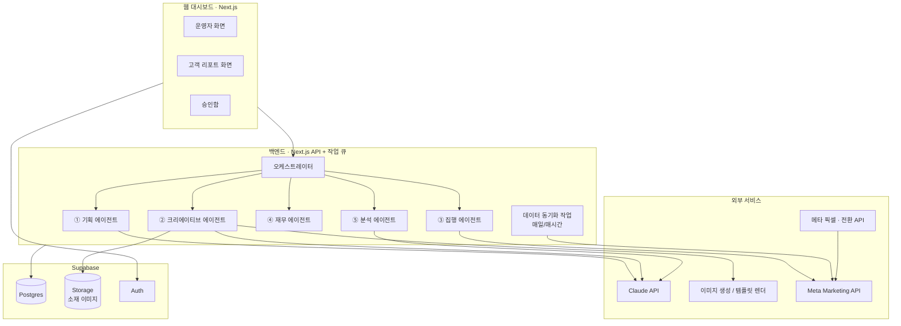
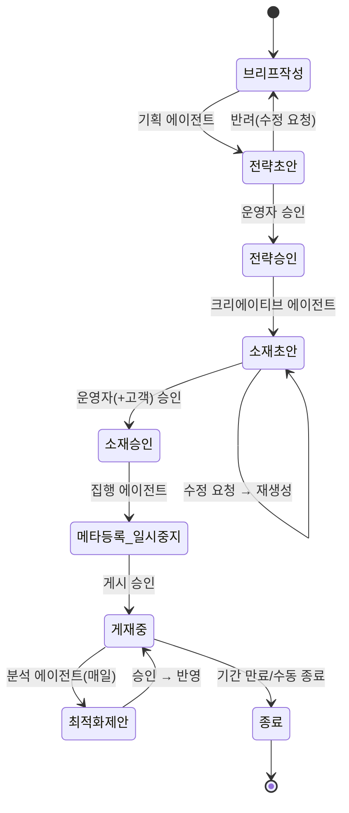
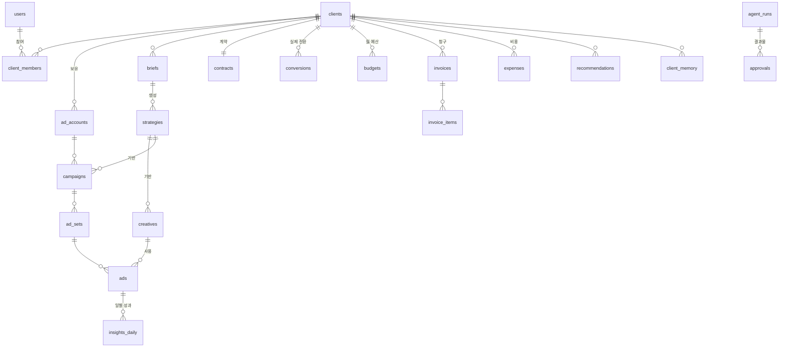

# Brief — AI 광고 마케팅 운영 시스템 기획서

> 버전 0.1 · 2026-10-29
> 목적: 1인 마케터가 **여러 고객의 메타 광고를 기획 → 소재 제작 → 집행 → 비용 관리 → 성과 보고**까지 한 곳에서 운영할 수 있도록, 반복 업무를 AI 에이전트에 맡기고 사람은 판단과 승인만 하는 시스템을 만든다.

---

## 목차

1. [제품 개요](#1-제품-개요)
2. [사용자와 권한](#2-사용자와-권한)
3. [전체 아키텍처](#3-전체-아키텍처)
4. [에이전트 정의](#4-에이전트-정의)
5. [핵심 워크플로우](#5-핵심-워크플로우)
6. [화면 구성](#6-화면-구성)
7. [데이터 구조](#7-데이터-구조)
8. [KPI 정의와 계산식](#8-kpi-정의와-계산식)
9. [메타 광고 API 연동 설계](#9-메타-광고-api-연동-설계)
10. [재무 관리 로직](#10-재무-관리-로직)
11. [안전장치·보안·리스크](#11-안전장치보안리스크)
12. [기술 스택과 폴더 구조](#12-기술-스택과-폴더-구조)
13. [단계별 로드맵과 완료 기준](#13-단계별-로드맵과-완료-기준)
14. [결정이 필요한 사항](#14-결정이-필요한-사항)

---

## 1. 제품 개요

### 1.1 해결하려는 문제

1인 마케터가 고객 1명의 광고를 운영할 때 반복되는 일:

| 업무 | 지금 방식 | 주당 소요(고객 1명 기준, 추정) |
|---|---|---|
| 광고 기획·타깃 설정 | 고객 미팅 → 문서 작성 | 2~3시간 |
| 카피·소재 제작 | 캔바/포토샵 수작업 | 3~5시간 |
| 메타 광고관리자 세팅 | 수동 입력 | 1~2시간 |
| 성과 확인·최적화 | 매일 광고관리자 접속 | 2~3시간 |
| 고객 리포트 | 엑셀 → PPT | 2시간 |
| 광고비·수수료 정산 | 엑셀 | 1시간 |

→ 고객 5명이면 주 50시간 이상. **고객 수를 늘리는 데 사람 시간이 병목**이 된다.

### 1.2 목표

- 고객 1명당 주간 운영 시간을 **10시간 이상 → 2시간 이하**로 줄인다.
- 사람이 하는 일은 **브리프 입력, 승인, 고객 커뮤니케이션** 세 가지로 좁힌다.
- 고객에게 **"광고비 X원 → 노출 → 클릭 → 문의 → 고객 Y명 → 매출 Z원"**을 한 화면으로 보여준다.

### 1.3 범위

| 포함 (v1) | 제외 (추후) |
|---|---|
| 메타(페이스북·인스타그램) 광고 | 구글·네이버·카카오·틱톡 광고 |
| 이미지·카드 소재 | 영상 소재 자동 생성 |
| 고객별 예산·수수료·청구 | 세무 신고, 회계 프로그램 자동 연동 |
| 운영자 대시보드 + 고객용 읽기 전용 리포트 | 고객이 직접 광고를 수정하는 기능 |

---

## 2. 사용자와 권한

| 역할 | 설명 | 할 수 있는 일 |
|---|---|---|
| **운영자 (Owner)** | 사장님 본인 | 모든 기능, 승인, 고객 추가, 재무 |
| **고객 (Client Viewer)** | 광고를 맡긴 고객사 담당자 | 자기 회사 리포트 열람, 소재 시안 피드백, 청구서 확인 |
| **에이전트 (System)** | AI 에이전트 | 초안 생성, 데이터 수집, 제안. **돈이 나가는 행동은 승인 없이는 불가** |

> 향후 직원·프리랜서를 쓰게 되면 `Operator(제한된 운영자)` 역할을 추가한다. 데이터 구조는 처음부터 여러 사용자를 받을 수 있게 설계한다.

---

## 3. 전체 아키텍처



**설계 원칙**

1. **에이전트는 "초안 생성기 + 제안자"**, 결정권은 사람에게 있다. 모든 에이전트 결과물은 `draft` 상태로 저장되고 승인함에 쌓인다.
2. **데이터가 먼저다.** 1단계에서 메타 데이터 수집과 대시보드를 먼저 만들고, 에이전트는 그 데이터를 읽어서 판단한다.
3. **모든 에이전트 실행은 기록한다** (`agent_runs`): 입력, 출력, 비용(토큰), 소요시간. 문제가 생기면 추적할 수 있어야 한다.
4. **메타에 만드는 모든 캠페인은 `PAUSED` 상태로 생성**한 뒤, 승인 버튼을 눌러야 `ACTIVE`로 바뀐다.

---

## 4. 에이전트 정의

각 에이전트는 **입력 → 처리 → 출력 → 승인 게이트**의 같은 틀을 따른다.

### ⓪ 오케스트레이터 (총괄 마케터)

| 항목 | 내용 |
|---|---|
| 역할 | 작업을 순서대로 다른 에이전트에 배분, 상태 관리 |
| 트리거 | 새 브리프 등록, 승인 완료, 일일 스케줄, 성과 이상 감지 |
| 출력 | 작업(`agent_tasks`) 생성·상태 변경 |
| 특징 | LLM이 아닌 **규칙 기반 상태머신**으로 구현 (예측 가능성·비용 절감). 판단이 필요한 부분만 하위 에이전트가 LLM 사용 |

### ① 기획 에이전트 (Strategist)

| 항목 | 내용 |
|---|---|
| 입력 | 고객 브리프(업종, 상품, 가격, 지역, 목표, 월 예산, 경쟁사, 기존 성과), 과거 캠페인 성과 |
| 처리 | 페르소나 도출 → USP·메시지 축 3개 → 퍼널 단계별 캠페인 구조 → 타깃·예산 배분안 |
| 출력 | `strategies` 레코드: 캠페인 목표, 타깃 정의, 메시지 축, 예산 배분표, 예상 KPI 범위 |
| 승인 게이트 | 운영자가 전략안을 승인하거나 수정한 뒤 다음 단계로 진행 |
| 모델 | Claude (고성능 모델), 구조화 출력(JSON 스키마) |

### ② 크리에이티브 에이전트 (Creative)

| 항목 | 내용 |
|---|---|
| 입력 | 승인된 전략, 고객 브랜드 키트(로고, 컬러, 폰트, 톤앤매너), 소재 규격 |
| 처리 | 메시지 축마다 카피 변형 3~5개(헤드라인, 본문, CTA) 작성 → 이미지 소재 생성 |
| 이미지 방식 | **A. 템플릿 렌더(기본):** 미리 만든 HTML/Canva 템플릿에 카피와 상품 이미지를 넣어 렌더링하므로 품질이 안정적이다. **B. AI 이미지 생성(보조):** 배경이나 연출 컷에만 사용한다. |
| 출력 | `creatives` 레코드(카피 + 이미지 파일), 규격별(1:1, 4:5, 9:16) 변형 |
| 검수 | 메타 광고 정책 체크리스트 자동 점검(과장 표현, 개인 속성 언급, 이미지 내 문구 비율 등) |
| 승인 게이트 | 운영자 승인 → (선택) 고객 피드백 링크 발송 → 최종 확정 |

### ③ 집행 에이전트 (Media Buyer)

| 항목 | 내용 |
|---|---|
| 입력 | 확정된 전략 + 소재 |
| 처리 | 메타 API로 캠페인 → 광고세트 → 광고 생성 (**모두 PAUSED**) |
| 출력 | `campaigns / ad_sets / ads`에 메타 ID 저장, 생성 결과 요약 |
| 승인 게이트 | "게시" 버튼을 눌러야 ACTIVE로 바뀐다. 예산 증액, 신규 게시, 타깃 변경은 항상 승인이 필요하다. |
| 자동 허용 (설정 가능) | 성과가 기준 미달인 **광고 일시중지**만 자동 실행 허용 옵션 (예: 3일간 CPA가 목표의 2배 이상이면 중지) |

### ④ 재무 에이전트 (Finance)

| 항목 | 내용 |
|---|---|
| 입력 | 일별 광고비(메타), 고객별 계약 조건(수수료 모델), 기타 비용 |
| 처리 | 예산 소진율·예상 월말 소진액 계산, 초과/미달 경고, 월별 청구서 초안 생성, 고객별 손익 계산 |
| 출력 | `budgets` 소진 현황, `invoices` 초안, 경고 알림 |
| 승인 게이트 | 청구서는 운영자 확인 후 발송 |
| 모델 | 계산은 **코드로**(정확성). LLM은 월간 재무 코멘트 작성에만 사용 |

### ⑤ 분석 에이전트 (Analyst)

| 항목 | 내용 |
|---|---|
| 입력 | `insights_daily`, 전환 데이터, 목표 KPI |
| 처리 | 이상 감지(전일 대비 급변, 피로도 상승: 빈도↑ CTR↓), 소재·타깃별 승자/패자 판정, 다음 액션 제안 |
| 출력 | `recommendations` (예: "소재 B 중지, 소재 A에 예산 30% 이동 → 예상 CPA -18%"), 주간 고객 리포트 초안 |
| 승인 게이트 | 제안을 승인하면 오케스트레이터가 집행 에이전트에 작업을 넘김 |

### 4.1 에이전트 공통 규칙

- 모든 출력은 **JSON 스키마로 검증**한 뒤 저장한다. 검증에 실패하면 1회 재시도하고, 그래도 실패하면 사람 확인 대기로 넘긴다.
- 프롬프트는 코드와 분리해 `prompts/` 폴더에서 버전 관리한다.
- 고객별 **메모리**(브랜드 톤, 금지어, 과거 승자 소재 패턴)를 `client_memory`에 쌓아 다음 기획에 반영한다.

---

## 5. 핵심 워크플로우

### 5.1 캠페인 생애주기 (상태머신)



### 5.2 일일 자동 루틴

| 시각 | 작업 |
|---|---|
| 매시간 | 오늘 광고비, 노출, 클릭 동기화 (예산 초과 감시용) |
| 매일 06:00 | 전일 데이터 확정 동기화(광고 단위, 일별) |
| 매일 07:00 | 분석 에이전트: 이상 감지 + 제안 생성 → 승인함 |
| 매일 07:10 | 재무 에이전트: 소진율 점검 → 경고 |
| 매주 월 08:00 | 고객별 주간 리포트 초안 생성 |
| 매월 1일 | 전월 청구서 초안 + 고객별 손익 리포트 |

### 5.3 운영자의 하루 (목표 시나리오)

1. 아침에 **승인함**을 연다. "제안 6건, 소재 시안 2건, 청구서 1건"이 대기 중이다.
2. 각 카드에서 근거(그래프)를 보고 `승인` 또는 `수정`을 누른다. 15분 정도 걸린다.
3. 고객에게 리포트 링크를 보낸다. 링크는 자동 생성된다.

---

## 6. 화면 구성

### 6.1 정보 구조 (IA)

```
/                       운영자 홈 (전체 요약)
/inbox                  승인함
/clients                고객 목록
/clients/[id]           고객 상세
   ├─ overview          고객 대시보드 (퍼널 + KPI)
   ├─ brief             브리프·브랜드 키트
   ├─ strategy          전략안
   ├─ creatives         소재 라이브러리
   ├─ campaigns         캠페인/광고세트/광고 트리
   ├─ finance           예산·청구·손익
   └─ reports           주간/월간 리포트
/finance                전체 재무 (모든 고객 합산)
/agents                 에이전트 실행 기록·비용
/settings               메타 연결, 알림, 자동화 규칙
/r/[token]              고객용 리포트 (로그인 없이 링크로 열람, 만료 기간 설정)
```

### 6.2 화면별 구성 요소

#### ① 운영자 홈 `/`
- **상단 KPI 카드 5개:** 이번 달 총 광고비 · 총 전환 · 평균 ROAS · 대행 매출 · 순이익
- **승인 대기 배지:** 항목별 건수와 바로가기
- **고객 건강도 표:** 고객명 | 예산 소진율 막대 | CPA(목표 대비 색상) | ROAS | 상태 아이콘(정상/주의/위험)
- **경고 피드:** "A고객 예산 92% 소진, 월말까지 6일", "B고객 소재 피로도 상승"

#### ② 승인함 `/inbox`
- 탭: 전체 / 전략 / 소재 / 게시 / 최적화 제안 / 청구서
- 각 카드: 에이전트 이름, 고객, 요약 한 줄, **근거 미니 차트**, 예상 효과, `승인`·`수정 요청`·`반려` 버튼
- 일괄 승인 기능 (체크박스)

#### ③ 고객 대시보드 `/clients/[id]/overview` ← **핵심 화면**
- **기간 선택:** 7일 / 30일 / 이번 달 / 사용자 지정, 이전 기간과 비교 토글
- **마케팅 퍼널 (가로형):**
  `광고비 ₩ → 노출 → 클릭 → 랜딩 방문 → 리드/장바구니 → 구매(고객) → 매출 ₩`
  단계마다 수치, 전환율, 이전 기간 대비 증감을 표시
- **KPI 타일:** CPM · CTR · CPC · CVR · CPA · ROAS · 빈도
- **추이 차트:** 일별 광고비(막대)와 CPA 또는 ROAS(선)
- **소재 성과 표:** 썸네일 | 노출 | CTR | CPA | ROAS | 판정(승자/관찰/중지 권장)
- **AI 인사이트 박스:** 분석 에이전트의 이번 주 요약 3줄 + 제안 링크

#### ④ 소재 라이브러리 `/clients/[id]/creatives`
- 그리드 보기: 썸네일, 상태(초안/승인/게재중/중지), 성과 배지
- 상세: 카피 변형, 규격별 미리보기(피드·스토리·릴스 모양), 정책 점검 결과, 버전 이력
- `새 소재 생성` 버튼: 메시지 축과 개수를 고르면 크리에이티브 에이전트가 실행된다

#### ⑤ 캠페인 `/clients/[id]/campaigns`
- 트리 테이블: 캠페인 → 광고세트 → 광고, 각 행에 상태 토글(승인 필요 표시)과 핵심 지표
- 메타 광고관리자로 바로 가는 링크

#### ⑥ 재무 `/clients/[id]/finance`, `/finance`
- 월 예산 대비 소진 게이지 + 월말 예상 소진액
- 계약 조건 카드(수수료 모델, 정산일)
- 청구서 목록(초안/발송/입금 완료)
- **고객별 손익:** 대행 매출 − 소재 제작비 − AI 사용료 − 기타 = 고객별 이익
- 전체 재무: 월별 매출·이익 추이, 고객별 매출 비중

#### ⑦ 고객용 리포트 `/r/[token]`
- 고객 대시보드에서 **내부 정보(수수료, 마진, 에이전트 로그)를 뺀** 읽기 전용 버전
- 소재 시안 피드백 버튼(좋아요/수정 요청 + 코멘트)
- PDF 다운로드

#### ⑧ 에이전트 기록 `/agents`
- 실행 목록: 시간, 에이전트, 고객, 상태, 소요시간, 토큰 비용
- 월별 AI 사용료 합계 (고객별 손익에 반영)

---

## 7. 데이터 구조

전체 SQL 초안은 [`docs/schema.sql`](./schema.sql) 참고. 아래는 개념 모델이다.



### 7.1 주요 테이블 요약

| 테이블 | 설명 | 핵심 컬럼 |
|---|---|---|
| `users` | 로그인 사용자 | id, email, name, role(owner/operator) |
| `clients` | 고객사 | id, name, industry, status, brand_kit(jsonb), target_kpi(jsonb) |
| `client_members` | 고객사 열람자 | client_id, user_id, role(viewer) |
| `ad_accounts` | 메타 광고계정 연결 | client_id, meta_account_id, currency, timezone, token_ref |
| `briefs` | 고객 브리프 | client_id, product, price, region, goal, monthly_budget, competitors, notes |
| `strategies` | 전략안 | brief_id, version, personas(jsonb), messages(jsonb), structure(jsonb), budget_split(jsonb), status |
| `creatives` | 소재 | client_id, strategy_id, message_axis, headline, body, cta, image_path, format, policy_check(jsonb), status, version |
| `campaigns` / `ad_sets` / `ads` | 메타 구조 미러 | meta_id, name, objective/targeting/creative_id, daily_budget, status, synced_at |
| `insights_daily` | 일별 성과 (광고 단위) | ad_id, date, spend, impressions, reach, frequency, clicks, link_clicks, landing_views, leads, purchases, purchase_value |
| `conversions` | 메타 밖 실제 전환 (CRM, 수기 입력) | client_id, date, source, customer_ref, revenue, attributed_ad_id |
| `contracts` | 계약 조건 | client_id, fee_model(percent/fixed/hybrid), fee_percent, fee_fixed, min_fee, billing_day, vat_included |
| `budgets` | 월 예산 | client_id, month, planned_spend, alert_threshold |
| `invoices` / `invoice_items` | 청구 | client_id, period, subtotal, vat, total, status(draft/sent/paid), due_date |
| `expenses` | 비용 | client_id(nullable), category(creative/ai/tool/etc), amount, date |
| `agent_runs` | 에이전트 실행 로그 | agent, client_id, input(jsonb), output(jsonb), status, tokens_in, tokens_out, cost_krw, duration_ms |
| `approvals` | 승인함 항목 | type, ref_table, ref_id, client_id, summary, payload(jsonb), status(pending/approved/rejected/changes), decided_by, decided_at |
| `recommendations` | 분석 제안 | client_id, kind, evidence(jsonb), expected_impact(jsonb), status |
| `client_memory` | 고객별 학습 메모 | client_id, kind(tone/banned_words/winning_pattern), content |
| `audit_log` | 모든 변경 기록 | actor, action, target, before, after, at |

### 7.2 설계 메모

- **금액은 정수(원 단위, `bigint`)로 저장**한다. 소수점 오차를 방지하기 위해서다.
- 메타 성과는 **광고 단위·일 단위**로만 저장하고, 상위 집계는 뷰(`v_campaign_daily`, `v_client_daily`)로 계산한다.
- 메타 데이터는 최대 28일까지 수치가 소급 수정되므로, **최근 28일치는 매일 다시 받아 덮어쓴다(upsert).**
- 모든 테이블에 Supabase **RLS(행 단위 보안)**를 적용한다. 고객 열람자는 자기 `client_id` 데이터만 볼 수 있다.

---

## 8. KPI 정의와 계산식

| 지표 | 계산식 | 의미 |
|---|---|---|
| 노출수 | impressions | 광고가 보인 횟수 |
| 도달 | reach | 본 사람 수 |
| 빈도 | impressions ÷ reach | 1인당 평균 노출. 3을 넘으면 피로도를 의심 |
| CPM | spend ÷ impressions × 1,000 | 노출 1,000회 비용 |
| CTR | link_clicks ÷ impressions | 클릭률 |
| CPC | spend ÷ link_clicks | 클릭당 비용 |
| CVR | conversions ÷ link_clicks | 클릭 → 전환율 |
| CPA / CPL | spend ÷ conversions | 전환(리드) 1건 비용 |
| ROAS | revenue ÷ spend | 광고비 대비 매출 |
| **CAC** | (광고비 + 대행 수수료 + 소재비) ÷ 신규 고객 수 | 고객이 실제로 부담하는 고객 획득 비용 |
| **LTV:CAC** | 고객 평생가치 ÷ CAC | 3 이상이면 건강한 수준 |
| 마케팅 효율(MER) | 전체 매출 ÷ 전체 마케팅비 | 어트리뷰션과 무관하게 보는 전체 효율 |

**표시 원칙**
- 모든 비율 지표는 **분자·분모를 기간 합계로 계산**한다. 일별 비율의 평균을 내면 안 된다.
- 목표 KPI 대비 색상: 목표 이내면 초록, 120% 이내면 노랑, 그 이상이면 빨강.
- 메타 보고 전환과 실제 전환(`conversions`)을 **나란히** 보여준다. 둘의 차이 자체가 고객에게 중요한 정보다.

---

## 9. 메타 광고 API 연동 설계

### 9.1 사전 준비 (사장님이 할 일)

1. 메타 **비즈니스 관리자(Business Manager)** 계정과 **비즈니스 인증**
2. Meta for Developers에서 **앱 생성** (유형: 비즈니스) 후 Marketing API 추가
3. **시스템 사용자** 생성 → 장기 액세스 토큰 발급
4. 각 고객의 광고계정을 **파트너로 공유** 받기 (고객 비즈니스 관리자 → 파트너 추가)
5. 필요 권한: `ads_read`(조회), `ads_management`(생성·수정), `business_management`
   - 처음에는 개발 액세스로 본인 계정에서 테스트하고, 고객 계정을 여러 개 운영할 때 **고급 액세스(Advanced Access)**를 신청한다.

### 9.2 사용 엔드포인트

| 용도 | 엔드포인트 | 비고 |
|---|---|---|
| 성과 조회 | `GET /act_{id}/insights` | `level=ad`, `time_increment=1`, `fields=spend,impressions,reach,frequency,clicks,inline_link_clicks,actions,action_values` |
| 대량 기간 조회 | 비동기 리포트(`POST .../insights` → 작업 ID 폴링) | 레이트리밋 회피 |
| 구조 동기화 | `GET /act_{id}/campaigns`, `/adsets`, `/ads` | 이름, 상태, 예산 |
| 이미지 업로드 | `POST /act_{id}/adimages` | 이미지 해시 반환 |
| 소재 생성 | `POST /act_{id}/adcreatives` | object_story_spec |
| 캠페인 생성 | `POST /act_{id}/campaigns` | `status=PAUSED` 강제 |
| 광고세트·광고 생성 | `POST /act_{id}/adsets`, `/ads` | `status=PAUSED` 강제 |
| 상태 변경 | `POST /{object_id}` `status=ACTIVE/PAUSED` | 승인 후에만 호출 |

### 9.3 운영 규칙

- **API 버전을 고정**하고(환경변수), 분기마다 업그레이드 여부를 점검한다.
- 응답 헤더의 사용량(`x-business-use-case-usage`)을 기록하고, 80%를 넘으면 동기화 주기를 자동으로 늦춘다.
- 토큰은 DB에 평문으로 저장하지 않는다. Supabase Vault 또는 환경변수 시크릿에 두고, DB에는 참조 키만 저장한다.
- 쓰기 작업(생성, 상태 변경)은 모두 `audit_log`에 남긴다.
- **특별 광고 카테고리**(금융, 고용, 주거, 정치) 고객은 브리프 단계에서 표시하고 타깃 제한을 자동 적용한다.

### 9.4 전환 추적

- 고객 웹사이트에 **메타 픽셀 + 전환 API(CAPI)** 설치를 온보딩 체크리스트에 넣는다.
- 오프라인 매장, 전화 문의 고객은 `conversions`에 CSV 업로드나 수기 입력으로 실제 전환을 기록한다. 향후 CRM과 연동한다.

---

## 10. 재무 관리 로직

### 10.1 수수료 모델 (계약별 선택)

| 모델 | 계산 | 예시 |
|---|---|---|
| 정률 | 광고비 × 요율 | 광고비 300만 × 15% = 45만 |
| 정액 | 월 고정 | 월 50만 |
| 혼합 | max(최소 수수료, 광고비 × 요율) | max(30만, 300만×10%) = 30만 |
| 성과 보너스(선택) | 목표 ROAS 초과분에 추가 요율 | 추후 |

### 10.2 광고비 결제 방식 (고객별 설정)

- **A. 고객 카드 직결제:** 고객 광고계정에 고객 카드를 등록한다. 대행사는 수수료만 청구한다. 리스크가 낮아 **기본값으로 권장**한다.
- **B. 대행사 선결제 후 재청구:** 광고비와 수수료를 함께 청구한다. 현금흐름 리스크가 있으므로 선입금 잔액(`prepaid_balance`)을 관리한다.

### 10.3 자동 계산

- **예상 월말 소진액** = 이번 달 누적 소진 ÷ 경과 일수 × 해당 월 일수
- 예상 소진이 예산의 110%를 넘거나 90% 미만이면 경고한다.
- **월 청구서 초안**: 계약 모델로 수수료를 계산하고, 결제 방식 B이면 광고비를 더한 뒤 부가세(10%)를 적용한다.
- **고객별 손익** = 대행 매출 − (소재 외주비 + AI 사용료 배분 + 툴 비용 배분)

> 부가세·해외 광고비 세금 처리 방식은 세무사 확인 후 확정한다(§14).

---

## 11. 안전장치·보안·리스크

### 11.1 돈이 걸린 안전장치

| 장치 | 내용 |
|---|---|
| 생성은 항상 PAUSED | 에이전트가 만든 캠페인은 승인 전까지 게재되지 않음 |
| 예산 상한 | 고객별 `일 예산 상한`, `월 예산 상한`을 설정한다. 이를 넘는 요청은 코드 레벨에서 거부한다(LLM 판단과 무관). |
| 증액 제한 | 한 번에 기존 예산의 +30%를 넘는 증액은 2단계 확인을 거친다 |
| 킬 스위치 | 설정 화면의 "전 고객 모든 광고 일시중지" 버튼 |
| 이중 기록 | 모든 쓰기 작업 전후 상태를 `audit_log`에 기록 |

### 11.2 보안

- Supabase Auth(이메일 매직링크 + 운영자는 2단계 인증)
- RLS로 고객 간 데이터 분리
- 고객 리포트 링크는 추측 불가능한 토큰과 만료일을 사용하고, 언제든 폐기할 수 있다
- 메타 토큰, Claude API 키는 서버 환경변수와 Vault에만 보관한다

### 11.3 리스크와 대응

| 리스크 | 대응 |
|---|---|
| 메타 정책 위반으로 광고 거부·계정 제한 | 소재 정책 자동 점검, 고객 업종별 금지어 사전 |
| AI가 사실과 다른 카피 작성(가격, 효능 과장) | 브리프의 "확정 사실"만 인용하도록 프롬프트 제약 + 승인 필수 |
| 메타 API 변경 | 버전 고정, 연동 코드를 `lib/meta/` 한 곳에 격리 |
| 어트리뷰션 불일치(메타 보고 ≠ 실제) | 실제 전환 입력 기능 + MER 병행 표시 |
| AI 비용 증가 | 에이전트별 월 한도, 실행 로그로 고객별 원가 추적 |

---

## 12. 기술 스택과 폴더 구조

| 영역 | 선택 | 이유 |
|---|---|---|
| 프론트 + API | **Next.js (App Router) + TypeScript** | 하나의 코드베이스, Vercel 배포가 간단 |
| UI | Tailwind CSS + shadcn/ui | 빠른 대시보드 구성 |
| 차트 | Recharts | 퍼널, 추이, 막대 |
| DB·인증·파일 | **Supabase** (Postgres, Auth, Storage, RLS) | 1인 운영에 적합한 관리형 서비스 |
| 스케줄·작업 큐 | Vercel Cron → Supabase 테이블 기반 작업 큐 (추후 Inngest 검토) | 단순하게 시작 |
| AI | **Claude API** (Agent SDK / tool use) | 기획, 카피, 분석 |
| 소재 렌더 | HTML 템플릿 → 서버에서 이미지로 렌더 (Playwright/Satori) | 브랜드 일관성 |
| 광고 | Meta Marketing API (Graph API) | — |
| 배포 | Vercel | — |

```
brief/
├─ app/
│  ├─ (owner)/              운영자 화면들
│  │  ├─ page.tsx           홈
│  │  ├─ inbox/
│  │  ├─ clients/[id]/...
│  │  ├─ finance/
│  │  ├─ agents/
│  │  └─ settings/
│  ├─ r/[token]/            고객용 리포트
│  └─ api/
│     ├─ cron/sync-meta/    동기화
│     ├─ cron/daily-agents/ 일일 에이전트 루틴
│     └─ approvals/         승인 처리
├─ agents/
│  ├─ orchestrator.ts       상태머신
│  ├─ strategist.ts
│  ├─ creative.ts
│  ├─ media-buyer.ts
│  ├─ finance.ts
│  └─ analyst.ts
├─ prompts/                 에이전트 프롬프트 (버전 관리)
├─ lib/
│  ├─ meta/                 Meta API 클라이언트 (유일한 접점)
│  ├─ kpi.ts                KPI 계산 (순수 함수 + 테스트)
│  ├─ finance.ts            수수료·청구 계산 (순수 함수 + 테스트)
│  └─ supabase/
├─ supabase/migrations/     DB 마이그레이션
├─ templates/creatives/     소재 HTML 템플릿
└─ docs/                    기획 문서
```

---

## 13. 단계별 로드맵과 완료 기준

| 단계 | 내용 | 완료 기준 (이게 되면 다음 단계) | 예상 기간* |
|---|---|---|---|
| **1. 성과 대시보드** | 프로젝트 뼈대, DB, 샘플 데이터로 고객 대시보드·홈 구현 → 메타 조회 연동(`ads_read`) | 실제 고객 1명의 지난 30일 퍼널·KPI가 메타 광고관리자 수치와 일치 | 1~2주 |
| **2. 재무** | 계약, 예산, 소진 경고, 청구서 초안, 고객별 손익 | 이번 달 청구서를 시스템에서 뽑아 실제로 발송 | 1주 |
| **3. 기획 + 크리에이티브 에이전트** | 브리프 → 전략안 → 카피·이미지 시안, 승인함 | 신규 캠페인 1건을 시스템에서 기획하고 소재까지 완성 | 2주 |
| **4. 집행 에이전트** | 승인 소재로 메타에 PAUSED 생성 → 게시 승인 | 광고관리자 수작업 없이 캠페인 1건 게재 | 1~2주 |
| **5. 분석 에이전트 + 리포트** | 일일 제안, 주간 리포트, 고객 링크 | 1주일 동안 매일 아침 승인함만으로 운영 | 1~2주 |
| **6. 확장** | 고객 피드백 루프, 멀티 채널, 판매용 SaaS 전환 검토 | — | — |

\* Claude Code로 함께 개발하는 기준의 대략적인 기간이며, 메타 앱 심사 대기 시간은 제외.

**1단계 MVP 구체 범위**
- [x] Next.js 프로젝트 생성 (Supabase 연결은 2단계에서 함께)
- [x] 샘플 데이터 생성기 (고객 3곳 × 70일 × 광고 4~6개)
- [x] `lib/kpi.ts` KPI 계산 함수 + 단위 테스트
- [x] 운영자 홈 (KPI 카드, 확인 필요 항목, 고객별 현황 표)
- [x] 고객 대시보드 (퍼널, KPI 타일, 추이 차트, 인사이트, 소재 성과 표)
- [x] 메타 Insights 조회 (토큰 + `clients.config.json` 설정 시 실제 데이터로 전환, 1시간 캐시)
- [x] 오늘의 결정함: 소재 중지·예산 증액(고객당 1개, 예산 초과 고객 제외)·소재 교체·예산 조정 결정을 돈 효과 순으로 제시, 승인/보류/무시 기록
- [x] 고객 공유 리포트 `/r/[링크]`: 서명·만료 링크, 쉬운 말 요약, 내부 정보 제외 (링크별 폐기는 2단계)
- [ ] 운영자 로그인 (외부 배포 전 필수)
- [ ] Supabase 저장 + 매일 동기화 작업 (2단계 재무 모듈과 함께)

---

## 14. 결정이 필요한 사항

개발을 진행하면서 사장님 확인이 필요한 항목입니다. 기본값으로 먼저 진행하고 나중에 바꿀 수 있습니다.

| # | 질문 | 기본값(가정) |
|---|---|---|
| 1 | 현재 운영 중인 고객 수, 주요 업종은? (커머스 / 로컬 매장 / 리드 수집) | 혼합: 커머스와 리드형 KPI를 모두 지원 |
| 2 | 주 전환 목표는 구매인가, 문의(리드)인가? | 고객별 설정 |
| 3 | 수수료 모델은? | 정률 15%, 최소 30만 원 혼합형 |
| 4 | 광고비는 고객 카드로 직결제하는가, 대행 결제하는가? | 고객 직결제 |
| 5 | 메타 비즈니스 관리자 인증과 개발자 앱이 있는가? | 없음 → 1단계는 샘플 데이터로 진행 |
| 6 | 고객에게 리포트 화면을 직접 열어줄 것인가? | 예 (읽기 전용 링크) |
| 7 | 소재 디자인 도구 선호 (자체 템플릿 / Canva / Figma) | 자체 HTML 템플릿 |
| 8 | 서비스 이름은 "Brief"로 확정인가? | 가칭 Brief |
| 9 | 부가세·해외 광고비 세금 처리 | 세무사 확인 필요 |
| 10 | 장기적으로 다른 마케터에게 판매할 계획이 있는가? | 있음 → 처음부터 멀티 테넌트 구조 |
