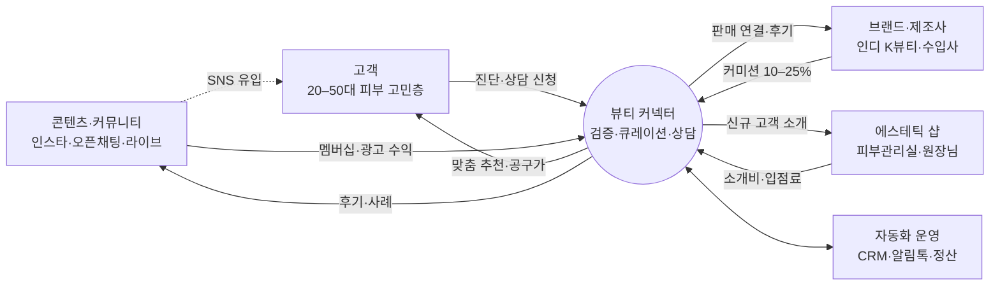
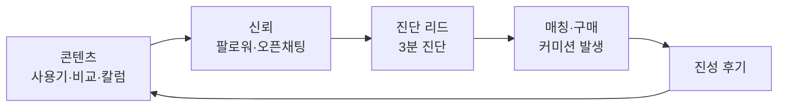
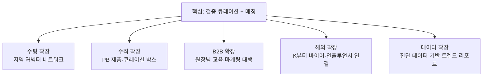

# 뷰티커넥트 사업 구조 · MVP · 확장 계획

> 대상: 화장품·에스테틱 분야에서 좋은 제품·서비스를 고객과 연결하는 "뷰티 커넥터"를 준비하는 대표님
> 전제: 1인 운영. 사람이 할 일은 **검증·상담·관계**만 남기고 나머지는 자동화한다.

---

## 1. 한 줄 정의

**"직접 써보고 가본 것만 추천하는 뷰티 큐레이터"** — 재고 없이 신뢰를 자산으로 삼아 고객 ↔ 브랜드·에스테틱 샵을 연결하고, 연결이 성사될 때와 커뮤니티에서 돈을 번다.

## 2. 사업 구조 (생태계)

| 주체 | 원하는 것 | 커넥터가 주는 것 | 커넥터가 받는 것 |
|---|---|---|---|
| 고객 | 광고 말고 믿을 만한 추천 | 진단 기반 맞춤 추천, 공구가, 사후 체크인 | 멤버십 비용, 공구 결제 |
| 브랜드 | 진성 후기와 판매 | 검증 배지, 타깃 고객, 콘텐츠 | 판매 커미션, 멤버십, 콘텐츠 제작비 |
| 에스테틱 샵 | 신규 고객 | 진단 정보가 붙은 예약 고객 | 소개비, 입점료 |

## 3. 수익 모델 (금액은 가정치, 계약 시 확정)

| 단계 | 수익원 | 구조 | 자동화 포인트 |
|---|---|---|---|
| 1 | 판매 커미션 | 판매가 10–25% | 제휴 링크·쿠폰코드로 자동 추적 |
| 1 | 샵 소개비 | 첫 결제액 10–20% 또는 건당 2–5만원 | 방문 확인 → 월말 정산서 자동 |
| 1 | 공동구매·큐레이션 박스 | 마진 25–40%, 월 1회 | 주문폼 → 발주 시트 → 배송 알림 |
| 2 | 파트너 멤버십 | 월 9.9만 / 29만원 | 정기결제 + 월간 성과 리포트 자동 발송 |
| 2 | 고객 유료 멤버십 | 월 9,900원 (공구 우선권·월 1회 상담) | 정기결제 + 전용 채널 자동 초대 |
| 3 | 콘텐츠·교육 | 브랜디드 콘텐츠 건당 30–100만원, 원장님 클래스 1인 15–30만원 | AI 초안 → 승인 → 예약 발행 |

**월 시뮬레이션 예 (가정)**: 상담 120건 × 성사 30% × 객단가 15만원 × 수수료 15% = 81만원, 멤버 80명 × 9,900 = 79.2만원, 유료 파트너 8곳 × 9.9만 = 79.2만원 → **월 약 240만원**. MVP 페이지의 시뮬레이터에서 값을 바꿔볼 수 있다.

## 4. 콘텐츠 사업화 방식

콘텐츠는 그 자체로 팔기보다 **유입 엔진 → 리드 → 매칭**으로 돈이 되게 설계한다.

| 포맷 | 목적 | 수익 연결 |
|---|---|---|
| 릴스·카드뉴스 (주 3회) | 유입 | 프로필 링크 → 진단 페이지 |
| 오픈채팅 커뮤니티 | 신뢰·재구매 | 공구 공지, 멤버십 전환 |
| 월 2회 라이브 | 전환 | 라이브 커머스, 브랜드 협찬비 |
| 커넥터 칼럼·뉴스레터 | 전문성 | 유료 멤버 전용 심화 콘텐츠 |
| 원장님 대상 마케팅 클래스 | B2B | 교육비, 샵 입점 유도 |

## 5. MVP 범위 (`mvp/index.html`)

| 화면 | 사용자 | 기능 |
|---|---|---|
| 소개 | 고객 | 가치 제안, 5단계 이용 흐름 |
| 피부 진단·매칭 | 고객 | 5문항 진단 → 제품 3 + 에스테틱 2 실시간 추천 → 상담 신청(동의 문구 포함) |
| 커뮤니티 | 고객 | 칼럼·후기·공구·라이브 피드, 후기 작성, 협찬 표시 |
| 파트너 | 브랜드·샵 | 검증 배지, 입점 기준, 입점 신청(플랜 선택) |
| 운영 대시보드 | 대표님 | 리드 목록·상태 변경, 파이프라인, 예상 수수료, 자동화 시나리오 |
| 사업 구조 | 대표님 | 생태계 도식, 수익 모델, 플라이휠, 시뮬레이터, 로드맵, 규제 |

현재는 브라우저 저장(localStorage) 데모다. 실서비스 전환 시 아래 순서로 붙인다.

1. 데이터: 상담·파트너·후기 → **Supabase** 또는 **노션 DB** (공유 저장)
2. 알림: 신규 리드 → **카카오 알림톡**(솔라피·알리고 등) + 대표님 휴대폰 푸시
3. 연결: **Zapier/Make**로 상태 변경 트리거 → 샵 알림, D+1 만족도, D+14 후기 요청, 월말 정산서
4. 결제: 멤버십·공구 → 토스페이먼츠/포트원 정기결제

## 6. 1인 운영 자동화 설계

| 트리거 | 자동 처리 | 사람 개입 |
|---|---|---|
| 상담 신청 | CRM 행 생성, 접수 알림톡 | 없음 |
| 상태 = 상담중 | 진단 요약 + 추천안 초안을 AI가 작성 | 대표님이 카톡 상담 (핵심 업무) |
| 상태 = 매칭 | 샵에 고객 카드 전송, 예약 시간 요청 | 없음 |
| 방문 D+1 | 고객 만족도 설문, 샵 방문 확인 요청 | 불만 건만 확인 |
| 방문 D+14 | 후기 요청 + 적립금 안내 | 없음 |
| 매월 1일 | 파트너별 정산서 생성·발송 | 최종 확인 1회 |
| 후기 등록 | 카드뉴스·릴스 대본 AI 초안 | 승인만 |

**목표**: 대표님 시간의 70% 이상을 상담·파트너 발굴·콘텐츠 기획에 쓰고, 반복 업무는 주 2시간 이하로.

## 7. 확장 로드맵

| 단계 | 기간 | 핵심 실행 | KPI |
|---|---|---|---|
| 0 노코드 검증 | 0–1개월 | 인스타·카카오 채널, 구글폼 진단 → 노션 CRM, 브랜드 10·샵 5 확보, 오픈채팅 | 리드 100 · 매칭 20 · 후기 10 |
| 1 MVP 웹 + 자동화 | 2–4개월 | 이 MVP를 공유 DB로 실서비스화, 알림톡·정산 자동화, 월 1회 공구 | 월 매출 300만 · 재구매 30% |
| 2 커뮤니티 유료화 | 5–9개월 | 고객 멤버십·파트너 구독, 월 2회 라이브, 원장님 클래스, 정기 박스 | 유료 멤버 300 · 파트너 20 |
| 3 네트워크 확장 | 10–18개월 | 커넥터 양성 과정 → 지역 커넥터 네트워크(수수료 분배), PB 제품(OEM/ODM), 해외 바이어 연결, 트렌드 리포트 | 커넥터 10명 · 지역 5곳 |

### 확장 축 정리

## 8. 규제·리스크 체크리스트

- **의료법**: 의원·피부과를 소개하고 수수료를 받으면 환자 유인·알선 금지 위반 소지. 연결 대상은 피부미용업(에스테틱)과 화장품으로 한정.
- **화장품법 광고**: "치료·재생·완치" 등 의약품 오인 표현 금지. 기능성은 심사받은 효능만.
- **추천·보증 표시**: 커미션·협찬 콘텐츠는 첫머리에 "광고/제휴" 표시 (공정위 추천·보증 심사지침).
- **통신판매**: 공구를 직접 판매하면 통신판매업 신고, 중개만 하면 통신판매중개자 고지.
- **개인정보**: 진단 결과를 샵에 제공할 때 제3자 제공 동의 별도 수집, 보관 기간 명시.

> 위 내용은 사업 설계용 일반 정보이며, 계약·광고 문구 확정 전 전문가 검토를 권장한다.

## 9. 이번 주 바로 할 일

1. MVP 링크로 지인 고객 10명에게 진단 테스트 → 추천 결과 납득도 확인
2. 브랜드 3곳·샵 2곳에 파트너 제안 (입점 기준·수수료안 전달)
3. 노션 CRM 템플릿 + Zapier 신규 리드 알림 1개 연결
4. 인스타 첫 콘텐츠 3개: 커넥터 소개 / 검증 기준 / 첫 사용기
