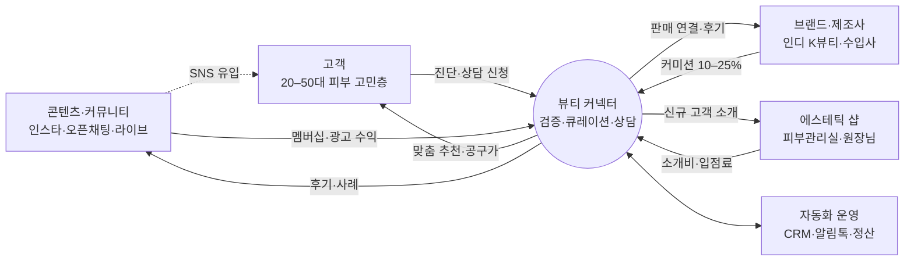
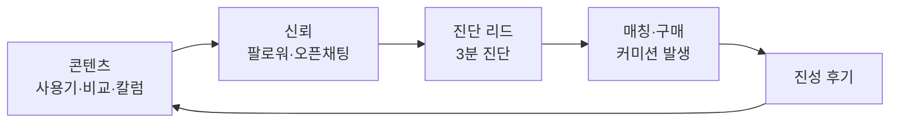
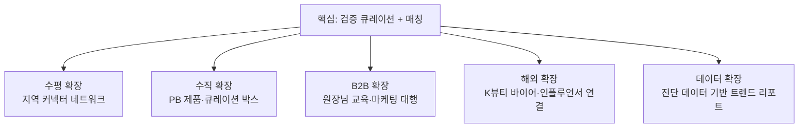
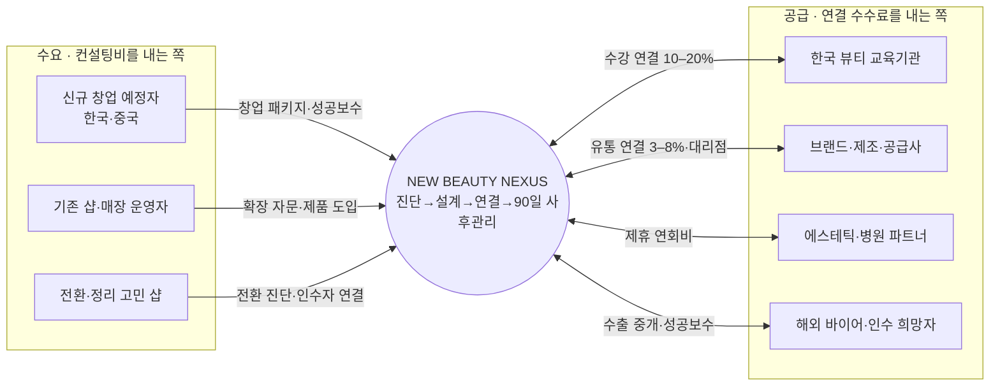

# 뉴뷰티넥서스(NEW BEAUTY NEXUS) 사업 구조 · MVP · 확장 계획

> 대상: 화장품·에스테틱 분야에서 좋은 제품·서비스를 고객과 연결하는 "뷰티 커넥터"를 준비하는 대표님
> 전제: 1인 운영. 사람이 할 일은 **검증·상담·관계**만 남기고 나머지는 자동화한다.

---

## 0. 브랜드 (명함·배너 반영)

| 항목 | 내용 |
|---|---|
| 브랜드 | NEW BEAUTY NEXUS · Beauty Business Connector |
| 슬로건 | "뷰티의 모든 연결을 더 쉽고, 더 똑똑하게" · Connecting K-Beauty, Creating New Business Opportunities · K-Beauty Beyond Borders |
| 대표 | 김은지 · 리추얼 설계자 · 스칼피스트 · 뷰티 비즈니스 컨설팅 & 커넥션 전문가 |
| 시장 | 한국 + 중국어권 (한·중 이중언어 운영) |
| 차별점 | 현장 기술(두피·리추얼)을 아는 컨설턴트 + 실제 고객을 보내줄 수 있는 커넥터 |

### 2트랙 구조

- **트랙 A · B2B 비즈니스 커넥팅 (주력)**: 창업 예정자·기존 샵 운영자 ↔ 교육기관·브랜드·공급사·파트너·해외 바이어. 건당 수백만원 단위 계약.
- **트랙 B · B2C 뷰티 큐레이션 (신뢰·리드 엔진)**: 피부 진단 → 검증 제품·에스테틱 매칭. 파트너 샵에 실제 고객을 보내준 기록이 B2B 영업의 증거가 된다. 아래 1–9장은 트랙 B 중심이며, 트랙 A는 10장에 정리했다.

### 실행 우선순위: 입구는 상담 컨설팅

상담으로 신뢰를 먼저 얻으면 그 뒤의 연결(교육·제품·공간·수출)은 쉽게 붙는다. 한 원장님과 **창업부터 정리까지** 함께하는 라이프사이클 구조로 간다.

| 단계 | 창업 준비 | 오픈 | 운영·확장 | 전환·이전 | 정리 |
|---|---|---|---|---|---|
| 입구 | **① 30대 신규 창업 상담** | | **② 기존 원장님 업종 추가 상담** | | |
| 서비스 | 창업 진단 리포트, 공간 결정 (1인샵/샵인샵/인수) | 교육기관 연계, 장비·제품 공급, 예약·홍보 세팅 | 업종 추가(두피·헤드스파), 수익모델 재설계, 해외 화장품 수출 연결 | 샵인샵 자리 구해주기·내주기, 샵 이전 시 인수자 찾기 | 폐업 절차, 장비 재판매, 고객 인계, 재창업·취업 연결 |
| 수익 | 창업 패키지·성공보수 | 교육·공급 연결 수수료 | 업종 추가 패키지·월 자문·수출 중개 | 매칭 성공보수 | 재판매 수수료·인수자 연결 |

| 시기 | 집중 | KPI |
|---|---|---|
| 지금 (0–3개월) | 30대 신규 창업 상담 (무료 30분 → 창업 진단 리포트 → 창업 패키지), 원장님 업종 추가 상담, 상담 접수 화면 + 사례 콘텐츠 주 2회 | 상담 30 · 유료 전환 5 |
| 다음 (3–9개월) | 교육기관 연계, 장비·제품 공급, **샵인샵·이전 매칭 보드**, K-두피 리추얼 도입 패키지 | 연결 매출 비중 40% · 공간 매칭 월 2건 |
| 나중 (9개월~) | 해외 화장품 수출·중국 트랙, 폐업·정리 지원 패키지, 지역·해외 커넥터 네트워크 | 수출 첫 건 · 라이선스 샵 10 |

**공간 순환 구조**: 이전·정리하는 원장님의 자리와 샵인샵 공간은 30대 예비 창업자에게 보증금·인테리어 부담이 적은 첫 시작점이다. 나가는 원장님과 들어오는 창업자를 양쪽에서 동시에 상담하므로 공간 매칭이 창업 상담의 차별점이 되고, 양쪽에서 성공보수가 나온다.

**샵인샵 주의**: 임차 공간을 다시 빌려주는 전대는 건물주 동의가 필요하고, 한 공간에 두 사업자가 영업신고를 할 수 있는지 시설 기준을 관할 구청에 먼저 확인한다.

**MVP 반영**: 고객 사이트에 "창업·원장님 상담" 탭(상담 유형 5개 → 맞춤 진행 순서 + 지역 공간 매물 → 무료 상담 신청)을 추가했고, 운영 대시보드에 B2B 상담 목록과 공간 자동 매칭 후보를 넣었다.

## 1. 한 줄 정의

**"직접 써보고 가본 것만 추천하는 뷰티 큐레이터"** — 재고 없이 신뢰를 자산으로 삼아 고객 ↔ 브랜드·에스테틱 샵을 연결하고, 연결이 성사될 때와 커뮤니티에서 돈을 번다.

## 2. 사업 구조 (생태계)

| 주체 | 원하는 것 | 커넥터가 주는 것 | 커넥터가 받는 것 |
|---|---|---|---|
| 고객 | 광고 말고 믿을 만한 추천 | 진단 기반 맞춤 추천, 공구가, 사후 체크인 | 멤버십 비용, 공구 결제 |
| 브랜드 | 진성 후기와 판매 | 검증 배지, 타깃 고객, 콘텐츠 | 판매 커미션, 멤버십, 콘텐츠 제작비 |
| 에스테틱 샵 | 신규 고객 | 진단 정보가 붙은 예약 고객 | 소개비, 입점료 |

## 3. 수익 모델 (금액은 가정치, 계약 시 확정)

| 단계 | 수익원 | 구조 | 자동화 포인트 |
|---|---|---|---|
| 1 | 판매 커미션 | 판매가 10–25% | 제휴 링크·쿠폰코드로 자동 추적 |
| 1 | 샵 소개비 | 첫 결제액 10–20% 또는 건당 2–5만원 | 방문 확인 → 월말 정산서 자동 |
| 1 | 공동구매·큐레이션 박스 | 마진 25–40%, 월 1회 | 주문폼 → 발주 시트 → 배송 알림 |
| 2 | 파트너 멤버십 | 월 9.9만 / 29만원 | 정기결제 + 월간 성과 리포트 자동 발송 |
| 2 | 고객 유료 멤버십 | 월 9,900원 (공구 우선권·월 1회 상담) | 정기결제 + 전용 채널 자동 초대 |
| 3 | 콘텐츠·교육 | 브랜디드 콘텐츠 건당 30–100만원, 원장님 클래스 1인 15–30만원 | AI 초안 → 승인 → 예약 발행 |

**월 시뮬레이션 예 (가정)**: 상담 120건 × 성사 30% × 객단가 15만원 × 수수료 15% = 81만원, 멤버 80명 × 9,900 = 79.2만원, 유료 파트너 8곳 × 9.9만 = 79.2만원 → **월 약 240만원**. MVP 페이지의 시뮬레이터에서 값을 바꿔볼 수 있다.

## 4. 콘텐츠 사업화 방식

콘텐츠는 그 자체로 팔기보다 **유입 엔진 → 리드 → 매칭**으로 돈이 되게 설계한다.

| 포맷 | 목적 | 수익 연결 |
|---|---|---|
| 릴스·카드뉴스 (주 3회) | 유입 | 프로필 링크 → 진단 페이지 |
| 오픈채팅 커뮤니티 | 신뢰·재구매 | 공구 공지, 멤버십 전환 |
| 월 2회 라이브 | 전환 | 라이브 커머스, 브랜드 협찬비 |
| 커넥터 칼럼·뉴스레터 | 전문성 | 유료 멤버 전용 심화 콘텐츠 |
| 원장님 대상 마케팅 클래스 | B2B | 교육비, 샵 입점 유도 |

## 5. MVP 범위 (`mvp/index.html`)

| 화면 | 사용자 | 기능 |
|---|---|---|
| 소개 | 고객 | 가치 제안, 5단계 이용 흐름 |
| 피부 진단·매칭 | 고객 | 5문항 진단 → 제품 3 + 에스테틱 2 실시간 추천 → 상담 신청(동의 문구 포함) |
| 커뮤니티 | 고객 | 칼럼·후기·공구·라이브 피드, 후기 작성, 협찬 표시 |
| 파트너 | 브랜드·샵 | 검증 배지, 입점 기준, 입점 신청(플랜 선택) |
| 운영 대시보드 | 대표님 | 리드 목록·상태 변경, 파이프라인, 예상 수수료, 자동화 시나리오 |
| 사업 구조 | 대표님 | 생태계 도식, 수익 모델, 플라이휠, 시뮬레이터, 로드맵, 규제 |

현재는 브라우저 저장(localStorage) 데모다. 실서비스 전환 시 아래 순서로 붙인다.

1. 데이터: 상담·파트너·후기 → **Supabase** 또는 **노션 DB** (공유 저장)
2. 알림: 신규 리드 → **카카오 알림톡**(솔라피·알리고 등) + 대표님 휴대폰 푸시
3. 연결: **Zapier/Make**로 상태 변경 트리거 → 샵 알림, D+1 만족도, D+14 후기 요청, 월말 정산서
4. 결제: 멤버십·공구 → 토스페이먼츠/포트원 정기결제

## 6. 1인 운영 자동화 설계

| 트리거 | 자동 처리 | 사람 개입 |
|---|---|---|
| 상담 신청 | CRM 행 생성, 접수 알림톡 | 없음 |
| 상태 = 상담중 | 진단 요약 + 추천안 초안을 AI가 작성 | 대표님이 카톡 상담 (핵심 업무) |
| 상태 = 매칭 | 샵에 고객 카드 전송, 예약 시간 요청 | 없음 |
| 방문 D+1 | 고객 만족도 설문, 샵 방문 확인 요청 | 불만 건만 확인 |
| 방문 D+14 | 후기 요청 + 적립금 안내 | 없음 |
| 매월 1일 | 파트너별 정산서 생성·발송 | 최종 확인 1회 |
| 후기 등록 | 카드뉴스·릴스 대본 AI 초안 | 승인만 |

**목표**: 대표님 시간의 70% 이상을 상담·파트너 발굴·콘텐츠 기획에 쓰고, 반복 업무는 주 2시간 이하로.

## 7. 확장 로드맵

| 단계 | 기간 | 핵심 실행 | KPI |
|---|---|---|---|
| 0 노코드 검증 | 0–1개월 | 인스타·카카오 채널, 구글폼 진단 → 노션 CRM, 브랜드 10·샵 5 확보, 오픈채팅 | 리드 100 · 매칭 20 · 후기 10 |
| 1 MVP 웹 + 자동화 | 2–4개월 | 이 MVP를 공유 DB로 실서비스화, 알림톡·정산 자동화, 월 1회 공구 | 월 매출 300만 · 재구매 30% |
| 2 커뮤니티 유료화 | 5–9개월 | 고객 멤버십·파트너 구독, 월 2회 라이브, 원장님 클래스, 정기 박스 | 유료 멤버 300 · 파트너 20 |
| 3 네트워크 확장 | 10–18개월 | 커넥터 양성 과정 → 지역 커넥터 네트워크(수수료 분배), PB 제품(OEM/ODM), 해외 바이어 연결, 트렌드 리포트 | 커넥터 10명 · 지역 5곳 |

### 확장 축 정리

## 8. 규제·리스크 체크리스트

- **의료법**: 의원·피부과를 소개하고 수수료를 받으면 환자 유인·알선 금지 위반 소지. 연결 대상은 피부미용업(에스테틱)과 화장품으로 한정.
- **화장품법 광고**: "치료·재생·완치" 등 의약품 오인 표현 금지. 기능성은 심사받은 효능만.
- **추천·보증 표시**: 커미션·협찬 콘텐츠는 첫머리에 "광고/제휴" 표시 (공정위 추천·보증 심사지침).
- **통신판매**: 공구를 직접 판매하면 통신판매업 신고, 중개만 하면 통신판매중개자 고지.
- **개인정보**: 진단 결과를 샵에 제공할 때 제3자 제공 동의 별도 수집, 보관 기간 명시.

> 위 내용은 사업 설계용 일반 정보이며, 계약·광고 문구 확정 전 전문가 검토를 권장한다.

## 9. 이번 주 바로 할 일

1. MVP 링크로 지인 고객 10명에게 진단 테스트 → 추천 결과 납득도 확인
2. 브랜드 3곳·샵 2곳에 파트너 제안 (입점 기준·수수료안 전달)
3. 노션 CRM 템플릿 + Zapier 신규 리드 알림 1개 연결
4. 인스타 첫 콘텐츠 3개: 커넥터 소개 / 검증 기준 / 첫 사용기

---

## 10. 트랙 A · B2B 비즈니스 커넥팅 (뉴뷰티넥서스 주력)

### 연결 구조

### 5대 서비스 라인 상품화 (가격은 가정치, 첫 3건으로 검증)

| 서비스 | 대상 | 상품 구성 | 가격 (가정) | 자동화 포인트 |
|---|---|---|---|---|
| 뷰티 창업지원 | 신규 창업 예정자 (한국·중국) | 상권·콘셉트 진단, 사업계획, 교육기관·공급사 매칭, 오픈 런칭 | 패키지 300–1,500만원 + 매칭 성공보수 | 사전 진단 설문 → 견적·제안서 초안 자동 |
| 사업 확장 컨설팅 | 기존 샵 운영자 | 신규 아이템(두피·리추얼) 도입, 수익모델 재설계, 객단가·재방문 개선 | 월 자문 50–150만원 (3개월~) | 월간 KPI 리포트 자동 |
| 제품 유통 연결 | 브랜드·공급사 ↔ 샵·해외 바이어 | 소싱, 샘플링, 납품·대리점 계약 중개 | 거래액 3–8% 또는 대리점 계약 수수료 | 샘플 신청 → 발주 → 정산 자동 |
| 파트너 네트워킹 | 에스테틱·병원·브랜드 | 정기 모임, 협업 매칭, 공동 프로모션 | 연회비 30–100만원 + 행사 참가비 | 멤버 디렉토리·행사 리마인드 자동 |
| 사업 전환 지원 | 운영난·전환 희망 샵 | 운영 진단, 업종 전환 설계, 영업 양도양수 희망자 연결 | 진단 50만원~ + 연결 성공보수 | 매물·인수 희망자 DB 자동 매칭 |

### B2B 고객 여정

| 단계 | 내용 | 방식 |
|---|---|---|
| 1 문의 | 명함 QR · 위챗 · 인스타 → 문의폼 | 자동 접수 |
| 2 사전 진단 | 예산·지역·경험·목표 10문항 | 자동 발송 |
| 3 진단 미팅 30분 | 대표님 핵심 업무 | 직접 |
| 4 제안서·계약 | AI 초안 → 검토 → 전자계약·착수금 | 반자동 |
| 5 실행·연결 | 교육기관·공급사·파트너 매칭 | 직접 |
| 6 90일 사후관리 | 30·60·90일 체크인, 후기·추천 요청 | 자동 |

### 시그니처 상품: K-두피 리추얼 프로그램 (확장성 1순위)

대표님의 스칼피스트·리추얼 설계 전문성을 매뉴얼로 표준화해, **시간을 파는 컨설팅 → 복제되는 상품**으로 전환한다.

- 샵 도입 패키지: 2일 교육 + 시술 매뉴얼 + 상담 스크립트 + 제품 키트 (도입비 + 키트 재구매)
- 인증 테라피스트 과정: 온라인 이론 + 오프라인 실습 (수강료)
- 파트너샵 라이선스: 국내·중국 샵에 프로그램명·매뉴얼 사용권 (월 로열티)
- 콘텐츠: 리추얼 시연 영상이 B2C 유입과 B2B 영업 자료를 동시에 해결

### 중국·글로벌 트랙 (K-Beauty Beyond Borders)

1. **채널**: 위챗 공식계정·샤오홍슈, 한·중 소개서, 문의 응대 템플릿 (이중언어 배너 보유)
2. **한국 연수 투어**: 교육기관 수강 + 샵 견학 + 공급사 미팅 3–5일 패키지 (1인 300–600만원 가정)
3. **현지화**: 중국 파트너샵 라이선스, 리추얼 키트 수출, 현지 에이전트 수익 분배
4. **자동화**: AI 번역으로 한·중 상담 기록·제안서 동시 작성, 시차 대응 자동응답

### 로드맵 반영 (7장 갱신)

| 단계 | 추가 실행 | KPI |
|---|---|---|
| 0 (0–1개월) | 한·중 소개서 + 명함 QR 문의폼, 교육기관 3곳 확보, 무료 진단 미팅 10건 | B2B 계약 2 |
| 1 (2–4개월) | 제안서·계약·정산 자동화, K-두피 리추얼 매뉴얼화·파일럿 샵 2곳 | 월 매출 800만 · B2B 월 2건 |
| 2 (5–9개월) | 분기 네트워킹 모임, 리추얼 도입 패키지·인증 과정, 위챗·샤오홍슈, 연수 투어 1회 | 도입 샵 10 · 투어 1회 |
| 3 (10–18개월) | 중국 파트너샵 라이선스·키트 수출, 해외 커넥터 네트워크, 양도양수 DB 정식 운영 | 라이선스 샵 10 |

### 추가 규제·리스크

- **병원 네트워킹**: 제휴·창업 컨설팅·제품 공급은 가능, 환자 소개 건당 수수료는 피한다. 중국 고객의 한국 시술 연결은 **외국인환자 유치업 등록** 후 진행.
- **중국 수출**: 화장품은 NMPA 등록·비안(备案) 필요. 등록 완료 브랜드부터 연결.
- **양도양수**: 영업 양도 중개는 가능, 상가 임대차·부동산 중개 해당 부분은 공인중개사와 협업.
- **컨설팅 계약**: 성과 보장 문구 금지, 범위·착수금·성공보수 서면화, 해외 계약은 통화·분쟁 조항 포함.
