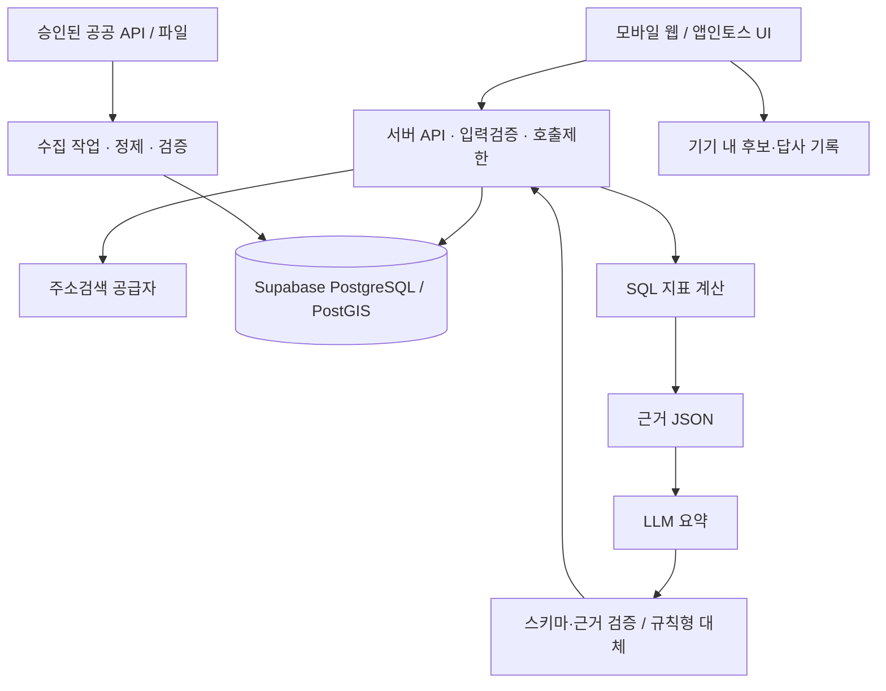

# AI 상권분석 미니앱 — 실행 가능한 MVP 설계 및 공공데이터·경쟁 서비스 조사

작성·공개 문서 확인일: **2026-11-07 (한국시간)**  
문서 성격: 개발 착수용 제품 요구사항 및 기술 설계. 실제 앱 구현·API 키 발급·실계정 호출·유료 서비스 체험은 수행하지 않았다.

> **권고안:** 부산의 카페 예비창업자가 후보 입지 두 곳을 비교하고, 현장에서 확인할 질문을 얻는 모바일 웹 MVP부터 만든다. AI는 검증된 통계를 설명하며, 개별 점포 매출·성공 확률을 만들어내지 않는다. 1인 개발 기준 4주 웹 베타 후 앱인토스 적용·검수를 별도 진행한다.

이전 대화의 AI 상권분석 요청을 이어받았다. 부산은 이전 관광앱 논의에 등장한 지역이므로 **이번 상권분석 앱의 확정 요구가 아니라 제안하는 초기 실험 지역**이다. 앱인토스 역시 배포 후보로 가정한다. 전국 확장보다 데이터와 사용자 반응을 먼저 검증한다.

본문의 기능·기준값·일정·예산·목표치는 별도 표시가 없으면 **제품 설계 제안**이다. 외부 서비스 사실은 인접한 공식 링크로 구분했다. 공개 문서 확인은 실데이터의 최신성·누락률·사용 승인을 보장하지 않는다.

## 1. 한 줄 정의

**“카페를 열기 전에, 두 후보지의 경쟁 환경과 주변 인구를 같은 기준으로 비교하고 답사할 일을 정하는 앱.”**

가칭: **상권첫걸음**. 상표·도메인 중복은 아직 확인하지 않았다.

### 1.1 MVP의 약속

- 주소와 업종을 선택하면 경쟁 점포 분포, 해당 행정동 인구 맥락, 데이터 한계를 한 화면에서 확인한다.
- 후보 A/B를 같은 업종·반경·자료 기준으로 나란히 비교한다.
- AI 설명의 각 주장에 근거를 연결하고, 추가 확인이 필요한 사항을 답사 체크리스트로 바꾼다.
- 목표 사용시간은 입력부터 비교 이해까지 3분 이내다. 실제 달성 여부는 베타에서 측정한다.

### 1.2 첫 출시 범위

| 항목 | 기본안 | 이유 |
|---|---|---|
| 지역 | 부산진구·수영구·해운대구 내 지원 주소 | 부산 생활권 실험, 관리 가능한 수집 범위 |
| 업종 | 카페 1종 | 업종 매핑·설명·현장검증의 복잡도 축소 |
| 공간 | 점포 집계는 반경 500m, 인구는 해당 행정동 | 서로 다른 통계 범위를 정직하게 표시 |
| 비교 | 후보 2곳 | 창업자의 실제 입지 선택 과제에 집중 |
| 플랫폼 | 모바일 웹 베타 → 앱인토스 웹 미니앱 | 데이터·사용성을 먼저 확인 |
| 회원 | P0 회원가입 없음, 기기 내 저장 | 첫 결과를 빠르게 경험 |
| 매출 | P0 제공하지 않음 | 전국 상가정보만으로 매출 추정 불가 |

반경 500m는 직선거리이며 도보 5분·생활권·상권 경계와 동일하지 않다. 해안·산·철도·대형 도로가 있는 부산에서는 특히 현장 접근성을 별도로 확인한다. 지원 구 경계에서 반경이 잘리지 않도록 **지원 지역 외곽 1km까지 점포를 함께 수집**한다.

## 2. 사용자와 문제

### 2.1 타깃·문제·가치

| 구분 | 내용 |
|---|---|
| 핵심 타깃 | 부산에서 처음 소규모 카페를 준비하며 후보 주소 2~3곳을 가진 예비창업자 |
| 이용 순간 | 부동산 방문 전, 후보지 답사 중, 임대 조건을 비교할 때 |
| 현재 문제 | 지도·공공 상권사이트·부동산 설명을 따로 보며 비교 기준이 달라짐 |
| 정보 해석 문제 | 주거인구를 유동인구로, 추정매출을 실제 매출로 오해하기 쉬움 |
| 제공 가치 | 동일 기준 비교 + 출처·시점 공개 + 다음 확인 행동 제시 |
| 비대상 | 대규모 프랜차이즈 출점 최적화, 투자 수익 보장, 실시간 매장 경영진단 |

사용자 과제: “오늘 두 곳 중 어디를 먼저 답사하고, 무엇을 확인해야 할지 알고 싶다.”

### 2.2 관련 앱·서비스 비교

네이티브 앱에 한정하지 않고 실제 대체재인 모바일 웹·공공 웹서비스를 포함했다. 아래 장점은 공식 소개 기준이며, 사용성 우열은 직접 사용자 테스트로 검증해야 한다. 현재 가격·무료 이용횟수는 로그인 후 조건까지 확인하지 않았으므로 단정하지 않는다.

| 서비스 | 공식적으로 확인한 특징 | 우리 MVP와의 관계 | 참고할 점·차별화 가설 |
|---|---|---|---|
| [소상공인365](https://bigdata.sbiz.or.kr/) | 빅데이터 상권분석, 내 가게 경영진단, 상권·시장 트렌드, 정책정보. [중기부 공식 발표](https://mss.go.kr/common/board/Download.do?bcIdx=1055654&cbIdx=160&streFileNm=594d0c98-209a-476e-99c6-949cc3add654.pdf) | 공공서비스 기반의 가장 직접적인 대체재 | 폭넓은 분석을 재현하기보다 후보 2곳 비교·답사 수행에 집중 |
| [서울시 상권분석 서비스](https://golmok.seoul.go.kr/introduce.do) | 지역·업종별 점포·매출·인구 정보와 창업예정지 분석 | 서울 확장 시 직접 경쟁, 부산 P0의 데이터 대안은 아님 | 공간 단위를 명확히 보여주는 분석 흐름 참고 |
| [오픈업](https://www.openub.com/) | 지도, 업종필터, 상권만들기, 창업계산, 매장보관함. AI 추정매출의 해석 한계 안내 | 지도 기반 입지 탐색과 겹침 | 추정치 고지 참고. 우리 앱은 공개 자료로 검증되지 않는 매출을 제공하지 않음 |
| [나이스비즈맵](https://m.nicebizmap.co.kr/) | 상권 종합보고서, 유동인구, 점포밀집도, 매출 관련 지표, AI 상담·리뷰 분석 소개 | AI 설명과 전문 리포트 모두 이미 경쟁 영역 | “AI가 있다”는 차별점이 아님. 근거 확인·짧은 비교·현장 기록을 함께 검증 |
| [카카오맵](https://apis.map.kakao.com/) | 지도·주소·장소·좌표 관련 기능 제공 | 사용자가 주변 가게를 찾는 참고 도구 | 지도 자체보다 비교 판단 보조가 제품 핵심. 리뷰 복제·크롤링은 범위 제외 |

### 2.3 차별화와 검증할 가설

1. **후보 비교 우선:** 여러 지표를 탐색하기 전에 A/B 차이를 먼저 제시하면 입지 검토 시간이 줄어든다.
2. **근거와 결측 공개:** 숫자의 공간 범위·기준시점·미제공 항목을 표시하면 사용자가 결과를 더 정확히 이해한다.
3. **답사까지 연결:** “경쟁이 많다”에서 끝내지 않고 대기줄·가격대·주차·동선 확인으로 이어지면 실용성이 높아진다.
4. **부산 카페에 좁힌 운영:** 해안·관광·경사지와 계절성은 현장 질문으로 다룬다. 공개 근거가 없으면 관광 수요 규모를 수치화하지 않는다.

위 요소가 경쟁 서비스에 전혀 없다는 뜻은 아니다. 독점 데이터도 없다. 방어력 후보는 사용자가 동의한 답사 기록, 데이터 품질 관리, 검증된 업종별 질문 체계이며 베타 이후 축적한다.

## 3. 핵심 여정

1. **진입:** “카페 후보지, 두 곳을 비교해 보세요.” 지원 지역·자료 한계 안내.
2. **입력:** 후보 A 주소 검색 → 지도 핀 확인 → 후보 B 선택. 업종은 카페, 반경은 500m 고정.
3. **결과:** 경쟁 점포·행정동 인구·근거 배지를 먼저 표시하고 AI 요약은 비동기로 추가.
4. **비교·행동:** 차이 확인 → 답사 체크리스트 선택 → 기기 내 저장.
5. **재방문:** 저장한 후보·체크리스트 확인. 자료 버전이 바뀌면 재분석 제안.

사용자가 한 곳만 입력해도 단일 분석을 제공한다. 후보 B 추가는 결과 화면에서 가능하다. 데이터 수집 완료 여부는 조회 실패와 구분한다.

## 4. 화면 흐름

| 화면 | 필수 구성 | 사용자 행동·전환 |
|---|---|---|
| S1 시작·검색 | 지원 지역, 주소 검색, 최근 후보 | 주소 선택 → S2 |
| S2 위치 확인 | 핀·주소·500m 원, 업종 정의, 후보 B 추가 | 분석 → S3 |
| S3 분석 결과 | 숫자 카드, 지도/목록, 기준시점, AI 요약, 한계 | 비교 → S4 / 근거 열기 / 저장 |
| S4 후보 비교 | 동일 지표 표, 해석 가능한 차이, 비교 불가 사유 | 답사 준비 → S5 |
| S5 답사·보관함 | 후보, 체크리스트, 짧은 메모, 삭제 | 체크·수정·재분석 |

근거 상세는 별도 페이지 대신 하단 패널로 제공한다. `출처 / 기준기간 / 공간범위 / 단위 / 계산법 / 수집일 / 누락 여부`를 표시한다.

### 4.1 결과 화면 예시 구조

```text
[후보 A · 카페 · 직선 반경 500m]
[자료 기준: 실제 적재한 스냅샷 날짜]

경쟁 점포          같은 업종 비중        주변 인구 맥락
{실제 집계}곳      {실제 계산}%          {행정동명·기준연도}
반경 500m         반경 내 전체 점포 기준  반경 내 인구가 아님

[지도 보기] [점포 목록 보기]

AI 해석
· 확인된 차이 → 근거 보기
· 해석 시 주의할 점
· 현장에서 확인할 질문 3개

[후보 B와 비교] [답사 목록에 저장]
```

### 4.2 예외 흐름

- **지원 지역 밖:** 지원 구 목록을 보여주고 분석 버튼 비활성화. 임의의 전국 결과를 생성하지 않는다.
- **주소 불명확:** 검색 결과 중 선택·핀 확인. 자동으로 첫 결과를 확정하지 않는다.
- **수집 실패:** 마지막 정상 자료가 있으면 날짜와 지연 상태를 표시. 없으면 재시도 안내.
- **점포 0개:** 완전 수집이 확인된 경우에만 0. 미수집·실패는 `확인 불가`.
- **인구 결측:** 카드에 `자료 없음`. 점포 분석만 제공하고 수요 판단을 제한한다.
- **AI 실패:** 숫자와 규칙형 체크리스트는 그대로 제공. AI 실패를 전체 분석 실패로 만들지 않는다.
- **뒤로가기:** 검색·후보 선택 상태 유지. 결과로 돌아올 때 중복 생성하지 않는다.
- **저장:** “이 기기에 저장됩니다. 브라우저 데이터 삭제 시 사라질 수 있어요.” 안내.
- **접근성:** 지도 없이 목록·표로 핵심 정보 확인. 색상 외 텍스트로 상태 구분.

## 5. SDK 도메인·권한과 배포

### 5.1 웹 베타와 앱인토스 분리

Lovable에서 모바일 웹 화면을 만들고, 검증 후 React DOM 기반 앱인토스 프로젝트에 적용한다. Lovable 웹 배포가 곧 앱인토스 등록·검수 완료를 뜻하지 않는다. 브라우저 저장·뒤로가기·외부 지도 이동은 호스트별 어댑터로 분리한다.

| 도메인 | P0/P1 | 용도 | 권한·대체 동작 |
|---|---|---|---|
| navigation | P0 | 화면 전환·뒤로가기 | 호스트 환경에서 동작 검증 |
| storage | P0 | 후보·답사 기록의 기기 내 저장 | 삭제 기능·저장 실패 안내 |
| analytics | P0 | 퍼널 측정 | 정확한 주소·메모는 이벤트에 넣지 않음 |
| location + permissions | P1 | 현재 위치로 검색 시작 | 선택적 geolocation, 거부 시 주소 입력 |
| auth | P1 | 여러 기기에서 보관함 동기화 | 계정 연동 설계 후 도입, P0에 불필요 |
| iap / ads | P2 | 유료 보고서·광고 검토 | 제품 검증 후 정책·약관 확인 |

P0는 위치 권한 없이 완결된다. 현재 위치는 앱 시작과 동시에 요구하지 않는다. 위치 기능 도입 시 공식 문서의 권한 상태와 거부 처리를 적용한다. [앱인토스 권한](https://developers-apps-in-toss.toss.im/documentation/common/permission), [위치](https://developers-apps-in-toss.toss.im/documentation/common/permission/location)

약관 준비 대상은 기본 사업자·워크스페이스 약관 `BIZ_WORKSPACE`; P1 토스 로그인 시 `TOSS_LOGIN`; P2 디지털 상품 결제 시 `IAP`, 광고 시 `IAA`다. 내부 식별자·실제 적용 조건은 등록 시 콘솔에서 재확인하며 본 문서는 동의나 등록을 수행하지 않는다.

실제 토스 앱에서 테스트 번들의 QR·테스트 스킴으로 검증한다. 정식 공유 스킴은 출시 이후 사용한다. [실기기 테스트](https://developers-apps-in-toss.toss.im/guide/operation/toss), [공유 링크](https://developers-apps-in-toss.toss.im/documentation/common/growth/share/miniapp-share-link)

## 6. 데이터·AI·DB·API 아키텍처

### 6.1 국내 공공데이터 소스와 채택 판단

#### D1. 소상공인시장진흥공단 상가(상권)정보 — P0 필수

- [공식 API 상세·신청](https://www.data.go.kr/data/15012005/openapi.do)
- 전국 상가업소 식별번호·상호·업종·주소·좌표 등. REST, JSON/XML, 반경·행정구역·수정일 기준 조회를 제공한다.
- 공개 페이지상 무료·이용허락범위 제한 없음, 개발·운영 자동승인, 개발계정 신청 가능 트래픽 10,000 표시. **10,000의 집계 기간·개별 승인량은 계정에서 재확인**한다.
- 페이지의 갱신주기는 실시간으로 표시되지만 실제 개폐업·현장 영업상태의 실시간 정확성을 뜻하지 않는다.
- 공식 Base URL: `https://apis.data.go.kr/B553077/api/open/sdsc2`.
- 활용 후보: `storeListInRadius`, `storeListInDong`, `storeListByDate`, `smallUpjongList`. 구체 파라미터·최대 페이지 크기는 게시된 최신 활용가이드와 실제 응답으로 확정한다.
- 대량 초기 적재는 [상가정보 파일데이터](https://www.data.go.kr/data/15083033/fileData.do)도 후보. 파일의 최신 기준일·제공 범위·이용 조건은 내려받기 전 별도 확인한다.
- **제공하지 않는 것으로 취급할 항목:** 개별 점포 실제 매출, 방문자, 임대료, 순이익. 카드사가 원천에 포함된다는 설명을 매출 필드 공개로 해석하지 않는다.

#### D2. SGIS 센서스·행정경계 — P0 인구 맥락, 취득 실패 시 축소

- [공식 개발지원센터](https://sgis.mods.go.kr/developer/html/), [API 목록](https://sgis.mods.go.kr/developer/html/newOpenApi/api/dataApi/introMajorApi.html)
- 인구·가구·사업체 통계, 행정경계, 좌표변환 등을 제공한다. P0는 해당 행정동의 총인구·연령 구성과 경계만 사용한다.
- 서비스 ID·보안 Key로 AccessToken을 발급한다. 현재 안내의 토큰 유효기간은 4시간이다. [인증 안내](https://sgis.mods.go.kr/developer/html/newOpenApi/api/dataApi/authAndUseApi.html)
- 연도별 센서스는 실시간 유동인구가 아니다. 제공 가능한 최신 연도·비공개/마스킹 값·호출량·상업 이용 및 가공·재배포 조건을 신청 단계에서 확인한다. 이번 조사에서는 해당 조건을 일괄 확정하지 않았다.
- 행정동·집계구 코드와 다른 기관 코드를 그대로 조인하지 않는다. 기준연도·코드체계를 포함한 매핑을 만든다. 좌표계는 응답별 명세를 확인한다.
- 1주차에 취득·이용 조건을 확정하지 못하면 인구 카드를 숨기고 **경쟁환경 비교 베타**로 범위를 축소한다. 인구가 있는 것처럼 AI가 보완하지 않는다.

#### D3. KOSIS 공유서비스 — P1 보완·교차검증

- [공식 이용안내](https://sso.kosis.kr/serviceInfo/openAPIGuide.do), [활용약관](https://sso.kosis.kr/serviceInfo/applicationClause.do)
- 통계목록·통계자료·통계표 설명 등을 API로 제공한다. 지역 인구·사업체 등의 맥락을 보완하는 후보.
- 인증키, 통계표별 식별자·항목코드·단위·시점이 필요하다. 월별/연별 여부는 선택한 통계표마다 다르다.
- **구현 전 확정:** 사용할 표 ID, 읍면동 제공 여부, 갱신주기, 호출량, 출처표시·재배포 조건. 모든 통계가 동 단위로 제공된다고 가정하지 않는다.
- SGIS와 같은 모집단·시점을 나타내는지 먼저 확인한다. 주민등록인구와 센서스 인구를 합산하지 않는다.

#### D4. 서울시 상권분석서비스 — P1 서울 전용 확장

- [추정매출-상권 OA-15572](https://data.seoul.go.kr/dataList/OA-15572/S/1/datasetView.do)
- 공식 페이지에서 분기별 갱신, 원 단위 추정매출, 파일·Open API, 공공누리 1유형(출처표시·상업적 이용·변경 가능)을 확인했다.
- **2026-07-03 적용 안내:** 공간 기준 변경에 따라 2021년 이후 자료만 제공한다고 명시되어 있다. 과거 저장 자료와 연결할 때 경계·코드 버전을 점검한다.
- 연관된 점포·영역·인구 데이터는 각 데이터셋의 이용 조건과 정의를 별도 확인한다.
- 서울 자료를 부산에 대입하지 않는다. 상권 전체 추정매출을 특정 주소·반경의 매출로 표시하지 않는다.
- API 인증키·서비스명·행 제한은 실제 사용 시 확정. [서울 API 안내](https://data.seoul.go.kr/together/notice/faqList.do?bbsCd=10002&ditcCd=FAQ02&seq=d47bc57aea53d6c6ab244c05a6eb2259)
- 성·연령별 합과 총매출의 차이를 오류로 단정하지 않는다. 총액에 법인매출이 포함될 수 있다는 공식 설명이 있다.

#### D5. 지방행정 인허가 — P1 개폐업 보조

- [2026년 공공데이터포털 통합 개방 안내](https://www.aigov.go.kr/promotion/notice/64), [이관 이용 매뉴얼](https://www.localdata.go.kr/images/egovframework/portal/manual_260106.pdf)
- 기존 LOCALDATA만 전제하지 않고 공공데이터포털에서 대상 인허가 업종의 최신 API를 찾는다.
- 일반음식점·휴게음식점 등 대상 업종별 인허가·영업상태 정보를 개폐업 점검에 활용하는 확장 후보다.
- 이번 조사에서는 개별 대상 API의 ID·필드·트래픽·이용허락을 확정하지 않았다. **P0 의존성에서 제외**한다.
- 인허가명·상호·업종과 상가정보가 일대일로 맞지 않을 수 있다. 인허가 폐업을 모든 사업체의 폐업으로 일반화하지 않는다. 허가일을 곧 실제 개점일로 표시하지 않는다.

#### D6. 부산 Big-데이터웨이브 — 지역 확장 탐색처

- [공식 포털](https://data.busan.go.kr/bdip/)
- 지역 관련 데이터와 민간 데이터가 함께 검색되는 포털이다. 부산 데이터라는 이유만으로 공공·무료·상업 이용 가능 API로 간주하지 않는다.
- 이번 조사에서 부산 전체를 대상으로 즉시 쓸 수 있는 **무료 개별 점포 매출 API는 확인하지 못했다**. 없다고 단정하는 의미는 아니다.
- 관광·교통 자료는 후속 가설 검증에 활용하되, 방문 수요나 매출로 자동 변환하지 않는다.

#### 지도·주소 검색: 공공데이터와 별도 계약인 민간 의존성

P0는 카카오 주소 검색과 지도 SDK를 후보로 한다. [주소·좌표 API](https://developers.kakao.com/docs/ko/local/dev-guide), [웹 지도 가이드](https://apis.map.kakao.com/web/guide/)

키·도메인 등록, 실제 무료량·초과 요금, 결과 저장·캐시·표시 조건과 앱인토스 WebView 동작을 개발 첫 주에 확인한다. 지도 콘텐츠를 자체 데이터처럼 재배포하지 않는다. 주소검색·지도 실패 시 후보 좌표 확인을 완료하지 못한 분석은 실행하지 않는다. 지도 표시만 실패하면 확정된 주소의 목록·표 결과는 제공한다.

### 6.2 1주차 데이터 검증 게이트

| 확인 | 실작업 | 통과 조건·대체안 |
|---|---|---|
| 상가 API | 키 발급, 부산 표본 10곳 조회, 전체 페이지 수집 | 응답·업종·좌표·총건수 일치. 실패하면 파일 적재 검토 |
| 업종 | 공식 분류 목록에서 카페 범위를 수동 확인 | 코드·명칭·분류버전 저장. 코드 문자열 추측 금지 |
| 인구 | SGIS 표본 행정동 조회·경계 대조 | 사용 조건과 시점 확정. 실패 시 인구 기능 제외 |
| 지도 | 운영 도메인·주소 검색·핀·모바일 표시 | 비용·표시·캐시 조건 수용 가능 |
| 시점 | 원자료 기준일과 수집일 각각 기록 | 수집일을 통계 기준일로 대체하지 않음 |
| 권리 | 출처·라이선스·표시·보관 조건 기록 | 조건 미확정 데이터는 공개 배포에서 제외 |

### 6.3 수집·정제 원칙

1. **수집:** 초기에는 부산 지원 지역과 경계 버퍼만 적재. 일 1회 변경 여부 확인은 운영 제안이며 원천 갱신주기와 별개다.
2. **완전성:** 페이지별 수집 상태·총건수·체크섬·재시도 기록. 일부 실패한 스냅샷을 운영용으로 승격하지 않는다.
3. **정제:** 좌표 오류·중복 ID·주소/지역 불일치 격리. 같은 건물의 서로 다른 점포는 임의로 합치지 않는다.
4. **업종:** 소상공인 분류↔서비스 업종 매핑을 버전 관리. 카페와 제과점 포함 범위를 UI에서 설명한다.
5. **공간:** WGS84 경위도 저장, 거리 계산은 미터 단위 geography 사용. 입력 순서는 경도·위도임을 테스트한다.
6. **삭제·폐업:** 현재 목록에서 사라졌다는 이유만으로 폐업 처리하지 않는다. 완전 스냅샷의 미관측 상태로 기록한다.
7. **승격:** 검증된 스냅샷만 활성화하고 이전 버전으로 되돌릴 수 있게 한다.
8. **보관:** 원자료 보관·캐시 허용 범위 내에서 원본과 정제 버전을 추적한다. 운영 로그에는 키·정확한 개인 위치를 기록하지 않는다.

### 6.4 정량 분석 방식

P0는 성공점수나 상권등급을 만들지 않는다. **경쟁이 적다고 좋은 입지인 것은 아니며**, 수요가 적을 가능성도 있다.

| 지표 | 계산·표현 | 해석 제한 |
|---|---|---|
| 동일 업종 점포 수 C | 같은 스냅샷에서 500m 안의 고유 점포 ID 수 | DB에 포착된 점포 수, 현장 전수 아님 |
| 동일 업종 비중 | C / 반경 내 수집된 전체 업종 점포 수 × 100 | 전체 점포가 0이면 null. 시장점유율 아님 |
| 최근접 동종 점포 거리 | 해당 업종 점포와의 최소 직선거리(m) | 실제 보행거리 아님 |
| 행정동 연령 구성 | 동일 연도·정의의 연령대 인구 / 총인구 | 방문객·카페 고객 연령대 아님 |
| A/B 차이 | 동일 정의의 A-B, 상대 변화는 B≠0일 때만 | 같은 행정동 인구면 같은 배경정보라는 표시 |

반경 점포 수를 행정동 인구로 나누어 “인구당 경쟁”을 계산하지 않는다. P1에서 해당 지표를 넣으려면 **분자·분모 모두 같은 행정동**으로 다시 집계한다. 서로 다른 연도·업종 분류·공간 기준의 후보는 `직접 비교 불가`로 표시한다.

서울 확장 시 매출 추이는 같은 상권 경계·업종·동일 분기 정의가 유지될 때만 계산한다. 추정 총매출을 점포 수로 나누려면 양쪽의 점포 모집단·기준기간 일치를 먼저 확인하며, 조건을 만족하지 않으면 계산하지 않는다.

### 6.5 AI 분석과 환각 방지

**구조:** SQL/서버가 숫자 계산 → 검증된 evidence JSON 생성 → LLM이 제한된 해석 작성 → 서버 검증 → 화면 표시.

P0에는 모델 학습, 벡터DB, 자유형 웹 검색, 자율 SQL 실행이 필요 없다. 근거는 승인된 지표와 업종별 현장 질문 템플릿에서만 가져온다.

입력 계약 예시(실측값이 아닌 구조 설명):

```json
{
  "report_version": "v1",
  "industry": "cafe",
  "evidence": [
    {
      "id": "E_COMPETITORS_A",
      "metric": "competitor_count",
      "value": null,
      "unit": "stores",
      "area_type": "radius",
      "radius_m": 500,
      "source_id": "SEMAS",
      "period": null,
      "snapshot_id": null,
      "status": "not_loaded"
    }
  ],
  "prohibited_claims": ["individual_sales", "success_probability", "real_time_footfall"]
}
```

AI 출력은 `observations[]`, `interpretations[]`, `field_checks[]`, `limitations[]`로 제한한다. 각 관찰·해석에 `evidence_ids`를 요구한다. 현장 질문은 `hypothesis` 또는 `checklist_template` 유형을 붙여 사실과 구분한다.

환각 방지 규칙:

- **숫자 렌더링 분리:** LLM이 숫자를 새로 작성하기보다 허용된 metric ID·비교 템플릿을 선택하고 서버가 값을 삽입한다.
- 근거 없는 “유동인구가 많다”, “월매출 ○천만원”, “성공률 ○%”를 차단한다.
- 상권 성공·실패 단정, 투자·임대 계약 권유, 인구 특성만으로 소비성향 확정은 출력하지 않는다.
- 입력하지 않은 월세·면적·자본금은 추측하지 않는다. 사용자 입력은 `user_provided`로 표기한다.
- 상호·메모·외부 텍스트는 데이터로 취급한다. 텍스트 내부의 명령을 실행하지 않는다.
- JSON 스키마, evidence ID 존재 여부, 단위·기간·부호, 금지 표현, 결측 상태를 검증한다.
- 검증 실패 시 최대 1회 재생성, 재실패·시간초과 시 규칙형 요약으로 대체한다.
- 모델·프롬프트·지표 버전을 기록하고, 스냅샷이 같은 입력은 캐시를 재사용한다.
- LLM에 사용자 식별자·정확한 현재 위치·자유 메모를 기본 전송하지 않는다. 집계 지표와 지역 수준 맥락만 전달한다.

**근거 상태 표시:** `확인된 자료 / 일부 누락 / 비교 제한`. 통계적으로 보정하지 않은 “신뢰도 92%” 같은 값은 사용하지 않는다.

**예시 해석(가상):** “후보 A의 반경 내 등록 카페 수가 B보다 많습니다. 경쟁점포 수만으로 수익성을 판단할 수 없습니다. 두 곳의 점심·주말 보행 흐름과 경쟁 카페의 가격대를 직접 확인해 보세요.” 실제 출력의 비교 문장은 검증된 차이가 있을 때만 사용한다.

### 6.6 시스템 구조



Supabase는 Postgres와 PostGIS 기반 공간 질의를 지원한다. Edge Functions는 API 키를 보호해야 하는 외부 호출에 사용하고, 대량 수집은 실행시간에 맞춰 페이지 단위 작업이나 별도 배치 실행기로 분리한다. [PostGIS 공식 문서](https://supabase.com/docs/guides/database/extensions/postgis), [Lovable의 Supabase 연동 설명](https://docs.lovable.dev/integrations/supabase)

### 6.7 최소 DB 설계

아래는 구현 계약 초안이다. 실제 DDL은 데이터 응답을 확인한 뒤 마이그레이션으로 작성한다.

| 테이블·영역 | 주요 필드·키 | 접근·제약 |
|---|---|---|
| `private.data_sources` | id, url, license, checked_at, expected_update_policy | 서버 관리, 이용 조건 추적 |
| `private.ingestion_runs` | id, source_id, status, page_count, expected_count, checksum, error | 관리자만 접근 |
| `private.snapshots` | id, source_id, source_period, fetched_at, version, complete | complete만 서비스 사용 |
| `private.stores` | snapshot_id + source_store_id 복합 PK, industry_code, address, location | geography(Point,4326), GiST 인덱스 |
| `private.industry_mappings` | source, source_version, source_code, app_industry, valid_from/to | 다대다 허용, 검토 상태 |
| `private.area_boundaries` | source + code + version, geom, area_type | MultiPolygon, 경계 버전 |
| `private.demographics` | area_id + period + metric 복합키, value, unit, suppressed, snapshot_id | null·마스킹과 0 구분 |
| `private.analysis_cache` | hash PK, canonical_input, snapshot_ids, metrics, ai_result, versions, expires_at | 개인 메모 제외, 서버 전용 |
| `private.analysis_jobs` | id, token_hash, status, cache_hash, expires_at | 무작위 조회 토큰, 짧은 보관 |
| `saved_candidates` (P1) | id, user_id, label, selected_place, created_at | 소유자별 RLS |
| `field_notes` (P1) | id, candidate_id, user_id, checklist, note | 소유자별 RLS·삭제 |

P0 후보와 메모는 로컬에 저장한다. 분석 요청·로그는 운영상 필요한 최소 기간만 유지하는 정책을 정하며, 제안값은 작업 상태 24시간·오류 로그 14일이다. 캐시·원자료 보관은 공급자 약관과 데이터 갱신 정책을 따른다.

### 6.8 보안·접근 제어

- 공공 API 키, LLM 키, Supabase secret/service-role 키는 서버의 비밀 저장소에만 둔다.
- 공개 스키마에 노출되는 테이블은 RLS 활성화와 명시적 권한 부여를 함께 검토한다. P0 원자료·캐시는 private 영역에서 서버만 접근한다.
- P1 저장 데이터는 `user_id = auth.uid()`에 해당하는 소유자만 읽고 수정한다. UPDATE는 기존 행과 변경 후 행을 모두 검사한다.
- 토스 로그인 사용자 ID를 Supabase UUID처럼 그대로 사용하지 않는다. 검증된 서버 인증 교환·내부 사용자 매핑을 별도 설계한다.
- 공개 분석 API는 클라이언트 키를 비밀 인증수단으로 취급하지 않는다. 요청 크기·반경·지원 구·동시 작업·IP/세션 호출량을 서버에서 제한한다.
- P0 제안 제한: 세션별 시간당 10회, 하루 30회 생성. IP 제한은 공유망 사용자를 고려해 더 완화하고 비용 상한도 별도 둔다.
- 수집 작업 API는 일반 앱에서 호출할 수 없게 한다. 관리자 권한 함수로 RLS를 임의 우회하지 않는다.
- 브라우저 지도 키는 공급자 허용 방식에 따라 도메인을 제한한다. 공개 지도 키와 서버 REST 비밀 키를 구분한다.

RLS·테이블 권한은 별개다. 현재 Supabase 변경 이력에는 신규 테이블의 Data API 자동 노출 변경과 CLI 기본 대상 변경이 있으므로 설치 버전을 고정하고 실제 권한을 검증한다. [RLS 문서](https://supabase.com/docs/guides/database/postgres/row-level-security), [변경 이력](https://supabase.com/changelog?types=breaking-change)

### 6.9 앱 내부 API 계약

다음 경로는 **우리 서비스가 구현할 API**이며 공공기관의 기존 경로가 아니다.

| 경로 | 요청·결과 | 규칙 |
|---|---|---|
| `GET /v1/places?q=` | 주소 후보·좌표·공급자 식별자 | 길이 제한, 공급자 캐시 조건 준수 |
| `GET /v1/coverage` | 지원 지역·업종·사용 가능 자료 버전 | 기능 가능 여부를 UI에서 사전 표시 |
| `POST /v1/analyses` | 후보 1~2개, industry, radius_m → 결과 또는 job_id | 서버 재검증, idempotency key |
| `GET /v1/analyses/{id}` | pending/complete/partial/failed + 결과 | 작업 조회 토큰 검증, 토큰은 URL 쿼리에 넣지 않음 |
| `POST /v1/feedback` | 유용성·오해 여부·오류 유형 | 정확한 주소·메모 자동 첨부 금지 |

분석 응답 공통 필드: `metrics`, `area_scope`, `evidence`, `source_periods`, `snapshot_ids`, `limitations`, `ai_status`, `metric_version`.

오류 분류: `400 INVALID_INPUT`, `422 OUTSIDE_COVERAGE`, `429 RATE_LIMITED`, `503 DATA_UNAVAILABLE`. AI만 실패하면 유효한 숫자 결과와 `ai_status=fallback`을 반환한다.

캐시 키는 정확히 정규화한 좌표·업종·반경·스냅샷·지표·프롬프트 버전을 포함한다. 서로 다른 위치를 임의의 큰 격자로 합쳐 같은 결과를 반환하지 않는다. 후보 순서를 바꾼 비교는 개별 후보 캐시를 재사용한다.

## 7. 수익화와 운영비

P0는 무료, 광고·결제 없이 진행한다. 무료 공공서비스가 강력하므로 “AI 요약만 유료”의 지불 의향을 낙관하지 않는다.

| 단계 | 검증할 상품 가설 | 조건 |
|---|---|---|
| P1 | 비교 보관·답사 기록·확장 리포트 | 사용자가 실제 반복 사용하거나 비용 지불 의향을 보일 때 |
| P2 | 1회 리포트 또는 창업 준비 기간 이용권 | 유료 의향 조사 후 가격 실험, 앱인토스 결제 정책 확인 |
| P2 | 창업 지원기관용 상담 보조 화면 | 별도 고객 인터뷰·데이터 권리 검토 |

가격은 미정이다. 가설 검증용 가격 예시를 실제 경쟁사 가격이나 확정 판매가로 사용하지 않는다. 광고·제휴가 생기더라도 분석 순위나 근거와 분리 표시한다.

### 7.1 비용 산정 방식

```text
월 비용 = DB/호스팅 고정비 + 지도·주소 검색비 + 배치 수집비
        + 캐시 미적중 AI 생성 수 × 실제 건당 AI 비용 + 로그·저장·전송비
```

베타 운영 예산 상한은 **월 10만원(개발 인건비·Lovable 작업 요금 제외)**으로 제안한다. 공급자 현재 요금 견적이 아니라 운영 제한값이다. 배포 전 각 계정의 요금·과금 설정을 확인한다. 예산 초과 시 AI만 규칙형 설명으로 전환하고 핵심 숫자 조회는 유지한다.

입력 3,000토큰·출력 800토큰을 초기 상한 가정으로 두고 실제 사용량을 측정한다. 긴 원자료 전체를 LLM에 전달하지 않는다.

## 8. 검수 리스크와 검증

### 8.1 주요 리스크

| 리스크 | 영향 | 대응·출시 조건 |
|---|---|---|
| 원자료 누락·지연 | 경쟁점포 오판 | 기준시점·결측 표시, 스냅샷 검증, 현장 표본 |
| 서로 다른 공간 단위 혼합 | 인구당 경쟁 등 잘못된 계산 | 반경과 행정동을 분리, 잘못된 비율 금지 |
| 분류·경계 변경 | 전후 비교 왜곡 | 소스·분류·경계 버전 기록 |
| AI 과신 | 수익·성공 보장처럼 오해 | 근거 검증·금지 주장 차단·한계 표시 |
| 데이터 권리 미확정 | 재배포 문제 | 사용 조건 확인 전 해당 소스 공개 제외 |
| 키·사용자 자료 노출 | 정보 유출·비용 증가 | 비밀키 서버 보관, RLS·작업 토큰·호출 제한 |
| 지도 WebView 문제 | 주소 확인 불가 | 실제 단말 검증, 표·목록 대체 |
| 앱인토스 검수 | 배포 지연 | 웹 베타와 출시 일정 분리, 카테고리·약관 재확인 |

카테고리는 비게임 도구를 제안한다. iframe으로 타 서비스 화면을 감싸는 구성, 사행성·프로모션 머니는 포함하지 않는다. 위치 권한은 P0 불필요하다. 서비스 약관·개인정보 처리·분석 한계 안내를 실제 수집 항목에 맞춰 준비한다. 여기서 법률상 신고·동의 의무를 일괄 확정하지 않는다.

### 8.2 출시 전 테스트

| 영역 | 테스트 | 통과 기준(제안) |
|---|---|---|
| 집계 정확성 | 고정 스냅샷과 독립 계산으로 후보 30곳 대조 | 점포 수·거리 계산 일치 |
| 경계 | 반경 경계·구 경계·경위도 뒤바뀜·좌표계 | 누락·축 뒤바뀜 없음 |
| 데이터 상태 | 0·null·마스킹·부분 페이지 실패·오래된 자료 | 상태가 정확히 구별됨 |
| 현장 대응 | 3개 구에서 층화 선정한 점포 30곳 확인 | 불일치율·원인 기록. 20% 초과 시 데이터 개선 후 확대 |
| AI | 정상·결측·상충·명령 삽입 등 100개 사례 | 근거 없는 숫자·성공확률·매출 생성 0건 |
| 인증·보안 | 타인 작업 토큰·만료 토큰·관리 API·비밀키 노출 | 무단 조회/변경 차단 |
| P1 RLS | 사용자 A/B 읽기·수정·삭제 교차 테스트 | 타인 데이터 접근 0건 |
| 장애 | 공급자 timeout·429·LLM 오류 | 데이터 상태 안내·대체 요약 정상 |
| 모바일 | 작은 화면·뒤로가기·키보드·지도 실패 | 표·목록으로 핵심 여정 완결 |

현장 30점포 검사는 품질 탐색이지 전체 정확도 보증이 아니다. AI 테스트 100건 통과도 운영 중 환각이 없다는 보증이 아니므로 신고·로그 표본 검토를 계속한다.

### 8.3 베타 지표와 의사결정

2주간 실제 카페 예비창업자 20명을 모집한다. 인터뷰 5명은 기존 도구와 MVP로 같은 비교 과제를 수행하고 순서 효과를 줄이도록 사용 순서를 나눈다. 모집은 본 문서 이후 수행할 작업이다.

| 지표 | 정의 | 목표·판단 |
|---|---|---|
| 분석 완료율 | 결과 본 사용자 / 분석 시작 사용자 | 70% 이상 |
| 비교 완료 | 두 후보 비교를 끝낸 참여자 | 20명 중 12명 이상 |
| 핵심 이해 | 반경 점포와 행정동 인구 차이를 설명한 참여자 | 20명 중 16명 이상 |
| 행동 전환 | 체크리스트를 선택·저장한 참여자 | 20명 중 8명 이상 |
| 첫 가치 도달 | 입력 시작→비교 핵심 파악까지 시간 | 중앙값 3분 이내 |
| 실제 유용성 | 기존 도구 대비 편리한 점을 구체적으로 말한 참여자 | 20명 중 12명 이상 |
| 재사용 | 최초 완료자 중 7일 안에 다시 분석·답사 기록 | 탐색 목표 25%, 단독 중단 기준으로 쓰지 않음 |
| 성능 | 캐시 숫자 결과 p95 / AI 포함 p95 | 3초 / 15초 이내 |
| 운영 오류 | 내부 오류로 실패한 분석 / 전체 유효 요청 | 2% 미만 |

이벤트는 `analysis_started`, `metrics_viewed`, `comparison_viewed`, `evidence_opened`, `checklist_saved`, `feedback_submitted`로 최소화한다. 기기 식별이 끊기는 비회원 재방문율은 과소 추정될 수 있음을 기록한다.

**진행:** 비교 완료·이해도·유용성이 목표를 충족하고 중요 데이터/보안 오류가 없으면 P1 진행.  
**수정:** 이해도가 낮으면 AI 확장보다 지표 설명·공간 표시 개선.  
**축소:** 인구 자료를 확보하지 못하면 경쟁 비교로 재포지셔닝.  
**중단·전환:** 충분한 사용 안내 후에도 비교가 기존 도구보다 유용하지 않다면 업종 확대·유료화 대신 답사 기록 도구로 전환 검토.

## 9. 범위·개발 순서·일정

### 9.1 P0 / P1 / P2

| 우선순위 | 기능 | 완료 기준 |
|---|---|---|
| P0 | 지원 지역·업종 확인, 주소·핀 확인 | 지원 밖 분석 차단, 후보 위치 명확 |
| P0 | 500m 경쟁점포 집계·지도/목록 | 버전·출처·완전성 표시, 경계 테스트 통과 |
| P0 조건부 | 행정동 인구 맥락 | SGIS 취득·권리 검증 통과 시만 제공 |
| P0 | 후보 2곳 비교 | 같은 정의로 비교, 불일치 시 사유 표시 |
| P0 | 근거 연결 AI 요약·규칙형 대체 | 환각 방지 테스트 통과 |
| P0 | 답사 체크리스트·기기 내 저장/삭제 | 재접속 후 보존, 삭제 동작 |
| P0 | 최소 운영 모니터링·호출/비용 제한 | API 실패·수집 실패·비용 임계 감지 |
| P1 | 다른 업종 2~3종·반경 300/1000m | 분류 매핑·반경별 검증 후 확장 |
| P1 | 로그인·클라우드 보관 | 인증 매핑·RLS 테스트 완료 |
| P1 | 인허가 기반 개폐업 보조 | API·업종 범위·시점 검증 |
| P1 | 서울 추정매출·상권 단위 비교 | 서울 전용 표시, 공간·모집단 일치 |
| P1 | 수동 임대료·비용 입력 계산기 | 가정 기반 손익분기 계산으로 명시, 예상매출 아님 |
| P2 | 유료 리포트·기관용 상담 보조 | 지불 의향·권리·결제 정책 검증 |
| P2 | 민간 유동인구·카드자료 계약 | 비용 대비 수요·재배포권 확보 |
| P2 | 개인화·추세 알림·전국 확대 | 반복 사용과 데이터 운영 안정성 확인 |

**v1 제외:** 자유형 AI 채팅, 개별 점포 매출 예측, 성공점수, 실시간 유동인구, 리뷰 무단수집, 임대료 자동 추정, 전체 전국 업종 지원, 결제·광고. 핵심 가치를 검증하기 전 비용·오해·데이터 의존성을 늘리기 때문이다.

### 9.2 Lovable → Supabase → Codex 개발 순서

순서는 한 번씩만 쓰는 직선 과정이 아니라 화면·데이터 계약을 고정한 뒤 짧게 반복하는 흐름이다.

| 단계 | 주 도구 | 실제 작업 | 다음 단계 조건 |
|---|---|---|---|
| 0 | 담당자 + Codex | 키·이용 조건 확인, 데이터 표본 검증, 업종 정의 | D1 가능 확인, D2 채택/축소 결정 |
| 1 | Lovable | S1~S5 모바일 화면, 가상 데이터·오류 상태, 2곳 비교 | 클릭 가능한 여정, 가상 데이터 표시 |
| 2 | GitHub 연결 | Lovable 프로젝트 저장소 연결, 기준 커밋·브랜치 규칙 | 코드 동기화 확인 |
| 3 | Supabase | 개발 프로젝트, PostGIS·테이블·권한·비밀 저장소 준비 | 원자료 private, 읽기 경로 검증 |
| 4 | Codex | 수집·정제·스냅샷 승격, 집계·내부 API·캐시 구현 | 표본과 독립 집계 일치 |
| 5 | Lovable + Codex | 가상 응답을 실제 API로 교체, 근거 표시·예외 처리 | 실제 수치로 전체 흐름 완료 |
| 6 | Codex | AI 근거 계약·검증기·규칙형 대체·테스트 | 100개 평가 사례 통과 |
| 7 | Codex + 담당자 | 성능·보안·모바일·사용자 베타, 수정 | 8절 출시 기준 통과 |
| 8 | 앱인토스 프로젝트 | 웹 미니앱 어댑터·빌드·실기기·등록·검수 | 별도 플랫폼 절차 완료 |

Lovable 공식 문서는 자체 Supabase 프로젝트 연결과 GitHub 동기화를 지원한다. 이 설계에서는 **소유한 Supabase 프로젝트 하나를 명시적으로 선택**하고 Lovable 기본 백엔드와 이중 운영하지 않는다. 화면 작업과 Codex 작업은 같은 파일을 동시에 변경하지 않도록 구분한다. [Supabase 연결](https://docs.lovable.dev/integrations/supabase), [GitHub 연결](https://docs.lovable.dev/integrations/github)

운영 DB를 만들기 전에 개발 환경에서 검증한다. 스키마·지표·프롬프트 변경은 버전 관리하고, UI가 보여주는 숫자는 API 결과만 사용한다. Lovable이 화면을 수정하면서 데이터 정의를 임의로 바꾸지 않도록 계약을 문서화한다.

### 9.3 바로 사용할 개발 지시문

**Lovable 화면 초안용**

```text
부산 카페 예비창업자를 위한 모바일 웹 '상권첫걸음'을 만들어줘.
S1 주소검색, S2 지도 핀 확인, S3 결과, S4 후보 두 곳 비교,
S5 답사 체크리스트와 기기 내 보관함으로 구성해줘.
처음에는 명확히 '가상 데이터'라고 표시한 fixture를 사용해줘.
반경 500m 경쟁점포와 행정동 인구는 서로 다른 공간 범위로 표시해줘.
모든 숫자 카드에 기준시점·출처·근거 열기를 넣어줘.
매출예측·성공점수·회원가입·결제는 넣지 말아줘.
로딩, 자료 없음, 지원 지역 밖, AI 실패, 지도 실패 상태를 포함해줘.
분석 API 응답 구조를 한 곳에서 관리하고 서버 비밀 키는 사용하지 말아줘.
```

**Codex 데이터 구현용**

```text
이 기획서 6절을 기준으로 D1 실제 응답부터 검증해줘.
API 키는 서버 환경변수에서만 읽고 출력하지 말아줘.
부산 지원 지역+1km 버퍼를 수집하고 페이지 완전성·좌표·업종을 검증해줘.
정상 스냅샷만 활성화하고 실패 시 이전 버전을 유지해줘.
거리 계산은 PostGIS geography 기반으로 만들고 독립 계산과 대조해줘.
외부 API 스키마를 추측하지 말고 최신 가이드와 실제 응답을 기준으로 해줘.
데이터 미수집·null·0을 구분하고 개별 매출·성공률은 계산하지 말아줘.
```

**Codex AI·검증용**

```text
서버가 만든 evidence JSON만 사용하는 요약 기능을 구현해줘.
숫자는 서버가 렌더링하고 AI는 허용된 근거 ID와 해석을 반환하게 해줘.
JSON 스키마·근거 ID·금지 주장 검증기를 만들고 실패 시 규칙형으로 대체해줘.
결측·기간 불일치·경계 불일치·명령 삽입·외부 API 장애를 테스트해줘.
실제 사용자 주소·메모·키가 로그나 모델 입력에 불필요하게 들어가지 않게 해줘.
```

### 9.4 개발 일정

전제: 1인 개발자가 주 5일, 하루 4~6시간 작업하며 필요한 계정·키와 모집 채널이 준비되어 있음. 승인·자료 제공·검수 대기는 별도다. 아래는 확정 납기나 공급자 처리시간 보장이 아니다.

| 주차 | 작업 | 산출물·게이트 |
|---|---|---|
| 1주차 | 데이터 10곳 표본·권리 확인, 카페 코드 매핑, Lovable 여정 | D1 가능, D2 채택/제외, 화면 초안 |
| 2주차 | DB·수집·스냅샷·공간 집계·API·실제 화면 연결 | 단일 후보·A/B 숫자 비교 동작 |
| 3주차 | AI 근거 검증·체크리스트·기기 저장·오류 처리 | 기능 완결, AI 평가·집계 검증 |
| 4주차 | 현장 표본·보안·성능·모바일 수정, 웹 베타 준비 | 출시 전 품질 기준 통과 |
| 5~6주차 | 예비창업자 20명 2주 베타·인터뷰 | 계속/수정/전환 판단 |
| 이후 병행 가능 | 앱인토스 적용·실기기·검수 제출 | 추가 개발 1~2주 예상, 심사·보완 기간 별도 |

첫날 할 일은 **D1 키 발급·부산 주소 3곳 조회·공식 카페 코드 확인·가상 화면 작성**이다. AI 연결보다 실제 데이터로 경쟁점포 숫자를 정확하게 만드는 일을 먼저 끝낸다.

### 9.5 최종 완료 기준

- [ ] 지원 주소 2곳을 선택해 같은 조건으로 분석·비교할 수 있다.
- [ ] 모든 핵심 숫자에 출처·시점·범위가 있고 결측은 0으로 표시되지 않는다.
- [ ] 인구를 제공한다면 확보·이용 조건·코드 매핑을 검증했다.
- [ ] AI가 없어도 숫자 비교와 답사 체크리스트가 동작한다.
- [ ] 후보·체크리스트 저장과 삭제, 재접속이 동작한다.
- [ ] 집계·AI·보안·장애·모바일 테스트가 통과한다.
- [ ] 비용 상한·키 관리·데이터 갱신 실패 대응을 마련했다.
- [ ] 베타 지표를 측정할 수 있고, 사용자가 결과의 한계를 이해한다.

### 9.6 조사 범위와 남은 확인 사항

공식 데이터 카탈로그·개발 문서·서비스 공개 소개를 확인했다. 유료 화면·로그인 전용 기능은 체험하지 않았고, API 키 없이 실제 데이터 응답을 검증한 것으로 주장하지 않는다. 부산의 민간 매출·유동인구 계약 조건, SGIS 이용 범위, 지도 요금·캐시 조건, 앱인토스 등록 조건은 실행 단계에서 확인해야 한다.

**이 문서의 개발 결정:** 전국 매출 예측 제품을 먼저 만들지 않고, 부산 카페 후보지의 근거 있는 비교·답사 지원을 먼저 검증한다. 후속 확장은 데이터 권리와 사용자 행동이 확인된 항목부터 진행한다.
