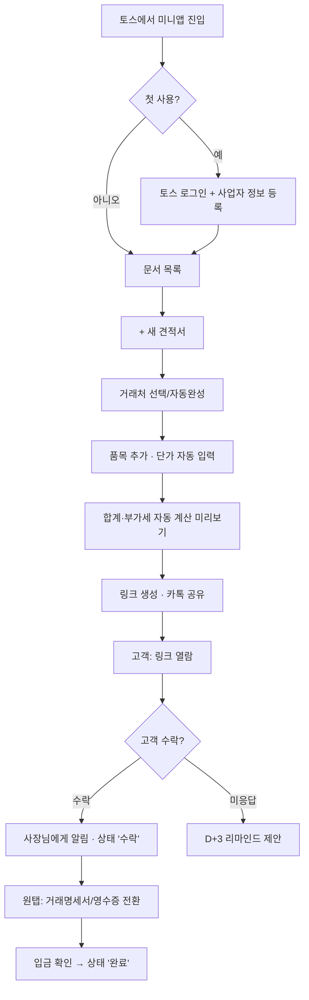

# 견적서·영수증 1분 생성 미니앱 기획서

> 앱인토스 미니앱 · 사무 축 · 1인 사업자용
> 작성일: 2026-11-10 · 버전: v0.1 (초안)
> 근거: 앱인토스 아이디어 보드 3위 (수요 4 · 구현 쉬움 4 · 운영 편함 4 · 수익성 5 = 17점, 브레인스토밍 추정치)

---

## 1. 한 줄 정의

**토스 안에서 1분 만에 견적서를 만들어 카톡으로 보내고, 고객이 수락하면 한 번 눌러 영수증(거래명세서)으로 바꿔주는 1인 사업자용 미니앱.**

## 2. 배경과 목표

### 2.1 왜 지금인가
- 프리랜서와 1인 사업자는 견적서를 아직도 엑셀·한글 양식이나 메모장 사진으로 보낸다.
- 같은 거래처, 같은 품목을 매번 다시 입력한다. 부가세 계산도 손으로 한다.
- 견적을 보낸 뒤 "수락했는지", "입금했는지"를 카톡 대화창을 뒤져서 확인한다.
- 토스는 사업자 사용자도 많고, 결제·송금과 맥락이 이어진다. 견적 → 수락 → 입금 흐름이 자연스럽다.

### 2.2 목표 (출시 후 3개월)
| 지표 | 목표 | 비고 |
|---|---|---|
| 월간 활성 사용자 | 3,000명 | 앱인토스 유입 기준 |
| 사용자당 월 문서 생성 수 | 4건 이상 | 반복 사용 여부 판단 |
| 무료 → 유료 전환율 | 3% | 월 90명 내외 |
| 견적 → 영수증 전환 비율 | 40% | 핵심 흐름이 쓰이는지 확인 |

> 모든 목표치는 가설이다. 출시 4주 차 데이터로 다시 잡는다.

## 3. 타깃과 페르소나

| 페르소나 | 상황 | 지금의 불편 | 원하는 것 |
|---|---|---|---|
| **현장형 사장님** (인테리어·설비·청소, 40대) | 현장에서 바로 견적 요청을 받음 | 사무실 가서 엑셀로 만들어야 함 | 폰으로 그 자리에서 보내기 |
| **프리랜서** (디자인·영상·개발, 30대) | 프로젝트마다 견적과 정산 | 양식이 들쭉날쭉, 부가세 헷갈림 | 깔끔한 양식, 자동 계산 |
| **소규모 매장·공방** (30~50대) | 단체 주문, 기업 납품 | 거래명세서·영수증 요청에 매번 당황 | 요청 오면 바로 발급 |

**1차 타깃은 현장형 사장님이다.** "현장에서 바로"라는 상황이 가장 뚜렷하고, 토스 안에서 끝나는 장점이 가장 크다.

## 4. 문제 정의

| 단계 | 지금 방식 | 문제 |
|---|---|---|
| 작성 | 엑셀·한글 양식 복사 | 폰에서 불편, 오타·계산 실수 |
| 계산 | 계산기로 공급가액·부가세 계산 | 원 단위 절사, 합계 불일치 |
| 전달 | 파일 첨부 또는 사진 캡처 | 고객 폰에서 깨지거나 안 열림 |
| 확인 | 카톡 대화 재확인 | 수락·입금 여부 추적 불가 |
| 발급 | 영수증을 새로 작성 | 견적 내용을 다시 입력 |

## 5. 핵심 가치

1. **1분 작성:** 거래처와 품목을 기억해 두었다가 자동완성한다.
2. **실수 없는 계산:** 공급가액, 부가세, 합계를 자동으로 계산한다.
3. **링크 한 줄 전달:** 고객은 앱 설치 없이 링크로 열람하고 [수락] 버튼을 누른다.
4. **원탭 전환:** 수락된 견적서를 한 번 눌러 거래명세서·영수증으로 바꾼다.
5. **자동 추적:** 수락, 미입금 상태를 목록에서 한눈에 보고 알림을 받는다.

## 6. 범위와 우선순위

### 6.1 발급 문서 범위 (중요)
| 문서 | MVP | 비고 |
|---|---|---|
| 견적서 | ✅ | 핵심 |
| 거래명세서 | ✅ | 견적서에서 전환 |
| 간이 영수증 (입금 확인증) | ✅ | 법적 적격증빙이 아님을 문서에 표기 |
| 전자세금계산서 | ❌ (v2 검토) | 국세청 연동 대행 API 필요 |
| 현금영수증 | ❌ | 범위 밖. 홈택스·결제 수단에서 발급 |

> 사용자가 "영수증 = 세금 증빙"으로 오해하지 않도록, 간이 영수증 하단에 "본 문서는 거래 확인용이며 세금계산서·현금영수증을 대신하지 않습니다" 문구를 고정한다.

### 6.2 기능 우선순위
| 기능 | 단계 | 우선순위 |
|---|---|---|
| 토스 로그인 | MVP | P0 |
| 내 사업자 정보 등록 (상호, 사업자번호, 대표, 주소, 연락처, 계좌, 도장 이미지) | MVP | P0 |
| 견적서 작성 (거래처, 품목, 수량, 단가, 유효기간, 메모) | MVP | P0 |
| 부가세 자동 계산 (과세·면세·간이 선택) | MVP | P0 |
| 고객용 열람 링크 + [수락] 버튼 | MVP | P0 |
| 카톡·문자 공유 | MVP | P0 |
| PDF·이미지 저장 | MVP | P0 |
| 견적서 → 거래명세서·영수증 원탭 전환 | MVP | P0 |
| 문서 목록 + 상태(작성·발송·열람·수락·입금완료) | MVP | P0 |
| 거래처·품목 자동완성 | MVP | P1 |
| 이전 견적 복제 | MVP | P1 |
| 열람·수락 시 토스 알림 | v1.1 | P1 |
| 미입금 리마인더 (D+3, D+7 알림) | v1.1 | P1 |
| 월별 매출 요약 (발행 금액 합계) | v1.1 | P2 |
| 엑셀 내보내기 (세무사 제출용) | v1.1 | P2 |
| 사진으로 품목 입력 (손글씨 견적 → AI 인식) | v2 | P2 |
| 전자세금계산서 발행 연동 | v2 | P3 |

## 7. 사용자 흐름



## 8. 화면 구성

| # | 화면 | 주요 요소 |
|---|---|---|
| S1 | 시작 / 사업자 등록 | 토스 로그인, 사업자 정보 입력(사업자번호 형식 검증), 도장 이미지 업로드(선택) |
| S2 | 문서 목록 (홈) | 상태 탭(전체·발송·수락·미입금·완료), 금액·거래처·날짜 카드, [+ 새 견적서] 고정 버튼 |
| S3 | 견적서 작성 | 거래처 입력(자동완성), 품목 행 추가(품목·수량·단가), 과세 유형 토글, 유효기간(기본 14일), 메모 |
| S4 | 미리보기 | 실제 양식 미리보기, 합계 강조, [링크 공유] [PDF 저장] [이미지 저장] |
| S5 | 문서 상세 | 상태 타임라인(작성 → 발송 → 열람 → 수락 → 입금), [영수증으로 전환] [복제] [리마인드] |
| S6 | 고객용 열람 페이지 (웹) | 앱 설치 없이 열림, 견적 내용, [수락하기] [문의하기], 계좌 정보 복사 |
| S7 | 설정 | 사업자 정보, 기본 유효기간, 기본 메모 문구, 구독 관리 |

**UX 원칙**
- 견적서 1장을 **탭 15번 이내**로 완성한다 (자동완성 기준).
- 숫자 입력은 숫자 키패드, 금액은 실시간 천 단위 쉼표.
- 입력 중 이탈해도 임시 저장한다.

## 9. 문서 양식 규격

### 9.1 견적서 필수 항목
- 문서 번호 (예: Q-2026-1110-001), 작성일, 유효기간
- 공급자: 상호, 사업자등록번호, 대표자, 주소, 연락처, (선택) 도장
- 공급받는 자: 상호 또는 이름, 연락처
- 품목 표: 품목명, 규격(선택), 수량, 단가, 공급가액
- 합계: 공급가액 합계, 부가세, 총액 (한글 금액 병기: "일금 일백십만원정")
- 비고: 결제 조건, 계좌 정보

### 9.2 계산 규칙
| 과세 유형 | 계산 |
|---|---|
| 일반과세 (부가세 별도) | 부가세 = 공급가액 합계 × 10%, **원 단위 미만 절사** |
| 일반과세 (부가세 포함 금액 입력) | 공급가액 = 총액 ÷ 1.1 (절사), 부가세 = 총액 − 공급가액 |
| 간이과세자 | 부가세 줄 대신 "간이과세자" 표기 (세금계산서 발급 가능 여부는 사용자가 설정) |
| 면세 | 부가세 0원, "면세" 표기 |

> 계산 로직은 단위 테스트로 고정한다. 합계 불일치는 신뢰를 한 번에 잃는 버그다.

## 10. 데이터 모델 (초안)

| 테이블 | 주요 필드 |
|---|---|
| `users` | id, toss_user_key, plan(free/pro), created_at |
| `businesses` | id, user_id, name, biz_no, owner, address, phone, bank_account, stamp_url, tax_type |
| `clients` | id, business_id, name, phone, memo, last_used_at |
| `items` | id, business_id, name, spec, unit_price, last_used_at |
| `documents` | id, business_id, client_id, type(quote/statement/receipt), number, status, issued_at, valid_until, supply_total, vat, total, tax_type, memo, parent_id(전환 원본), share_token |
| `document_lines` | id, document_id, item_name, spec, qty, unit_price, amount |
| `document_events` | id, document_id, type(sent/viewed/accepted/paid/reminded), at |

- `share_token`은 추측 불가능한 무작위 값으로 만들고, 고객용 페이지는 이 토큰으로만 접근한다.
- 고객 전화번호 등 개인정보는 최소한으로 저장하고, 탈퇴 시 함께 삭제한다.

## 11. 수익 모델

| 플랜 | 가격 (가설) | 내용 |
|---|---|---|
| 무료 | 0원 | 월 5건, 문서 하단 "앱 이름으로 만든 문서" 표기, 목록 화면 배너 광고 |
| 프로 | 월 4,900원 | 무제한, 표기 제거, 도장·로고, 미입금 리마인더, 엑셀 내보내기 |
| 프로 연간 | 연 49,000원 | 2개월 무료 효과 |

- 유료 전환 지점: **6번째 문서를 만들 때**, **리마인더를 처음 켤 때**.
- 결제는 앱인토스에서 제공하는 결제 수단(토스페이·인앱 결제)으로 붙인다. 정기 결제 지원 범위와 수수료는 착수 전에 앱인토스 개발자 문서에서 확인한다.
- 고객용 열람 페이지에는 광고를 넣지 않는다. 사장님의 신뢰가 걸린 화면이다.

## 12. 기술 구조

```
[토스 앱]
  └─ 앱인토스 미니앱 (WebView, React + TypeScript + Vite)
        ├─ 토스 로그인 / 결제 / 공유 (앱인토스 SDK)
        └─ API 호출
[백엔드] Supabase
  ├─ Postgres (위 데이터 모델, Row Level Security로 사업자별 격리)
  ├─ Edge Functions: 문서 번호 발급, PDF 생성, 알림 발송, 리마인더 스케줄
  └─ Storage: 도장·로고 이미지, 생성된 PDF
[고객용 열람 페이지] 일반 웹 (같은 React 코드에서 별도 라우트)
```

- **WebView 방식**을 고르는 이유: 같은 코드로 고객용 웹 페이지와 이후 구글플레이 앱(WebView 래핑)까지 재사용할 수 있다.
- **PDF 생성:** MVP는 브라우저에서 HTML → PDF로 만들고, 한글 폰트 깨짐이 생기면 서버 생성으로 옮긴다.
- **알림:** 열람·수락 이벤트는 `document_events`에 쌓고, 앱인토스 메시지 기능으로 사장님에게 보낸다. 지원 범위는 착수 전에 확인한다.

## 13. 1인 사업자 운영 자동화 포인트

이 앱은 **만든 사람이 손을 덜 대도록** 설계한다.

| 영역 | 자동화 방법 |
|---|---|
| CS | 앱 안 FAQ 10개 + 문의는 폼으로만 받고, Claude로 1차 답변 초안 작성 |
| 양식 업데이트 | 양식은 템플릿 1개 + 설정값으로만 바꾼다 (코드 수정 없이) |
| 리마인더 | 스케줄러가 매일 오전 미입금 문서를 찾아 알림 |
| 지표 확인 | 주 1회 핵심 지표(가입·문서 수·전환율)를 노션이나 아이디어 보드로 자동 리포트 |
| 결제 실패 | 구독 결제 실패 시 자동 안내 → 3일 후 무료로 자동 전환 |

## 14. 개발 일정 (4주 MVP)

| 주차 | 할 일 | 산출물 |
|---|---|---|
| 1주 | 앱인토스 개발자 등록·샌드박스 세팅, DB 설계, 사업자 등록·로그인 | 로그인되는 빈 앱 |
| 2주 | 견적서 작성·계산·미리보기, 거래처·품목 자동완성 | 견적서 1장 완성 |
| 3주 | 고객용 링크·수락, PDF·이미지 저장, 영수증 전환, 상태 목록 | 핵심 흐름 완성 |
| 4주 | 무료 한도·결제, 버그 수정, 지인 사장님 5명 베타 테스트, 심사 제출 | 출시 후보 |

## 15. 검증 계획

1. **출시 전:** 지인 사장님 5명에게 실제 견적 1건씩 이 앱으로 보내게 한다. "엑셀보다 빠른가?"만 묻는다.
2. **출시 2주:** 문서 생성 → 공유 → 수락까지 단계별 이탈률을 본다. 가장 많이 빠지는 단계 하나만 고친다.
3. **출시 4주:** 무료 한도(5건)를 다 쓴 사용자 중 결제 비율을 본다. 1% 미만이면 가격보다 가치(리마인더·도장) 문제로 보고 기능을 조정한다.

## 16. 리스크와 대응

| 리스크 | 영향 | 대응 |
|---|---|---|
| 간이 영수증을 세금 증빙으로 오해 | 고객 분쟁, 신뢰 하락 | 문서 하단 고정 문구, 첫 발급 시 안내 |
| 부가세 계산 오류 | 치명적 | 계산 단위 테스트, 합계 검증 로직 |
| 고객용 링크 유출 | 거래 정보 노출 | 무작위 토큰, 만료 기간, 사장님이 링크 비활성화 가능 |
| 앱인토스 심사 반려 | 출시 지연 | 착수 전 심사 가이드 확인, 결제·개인정보 문구 사전 점검 |
| 정기 결제 미지원 또는 제한 | 수익 모델 변경 | 건별 결제(예: 10건 묶음) 대안 준비 |
| 기존 견적 앱과 경쟁 | 유입 부족 | "토스 안에서 끝남 + 고객 수락 추적"에 집중, 기능 경쟁은 하지 않음 |

## 17. 출시 체크리스트

- [ ] 앱인토스 개발자 등록 및 사업자 정보 입력
- [ ] 개인정보 처리방침·이용약관 페이지
- [ ] 부가세 계산 테스트 케이스 20개 통과
- [ ] 한글 폰트 PDF 출력 확인 (안드로이드·iOS)
- [ ] 고객용 페이지를 카톡 인앱 브라우저에서 열어 확인
- [ ] 무료 한도·결제·해지 흐름 확인
- [ ] 간이 영수증 고지 문구 확인
- [ ] 베타 사장님 5명 피드백 반영

## 18. 다음 액션

1. 앱인토스 개발자 문서에서 **로그인·결제(정기 결제 여부)·메시지 발송** 지원 범위를 확인한다.
2. 내가 실제로 쓰는 견적서 양식 1장을 기준 양식으로 정한다.
3. 1주 차 작업(로그인 + 사업자 등록)부터 Claude Code로 개발을 시작한다.

---

### 부록 A. 확장 로드맵 (앱인토스 → 구글플레이)

| 단계 | 채널 | 내용 |
|---|---|---|
| 1 | 앱인토스 | 견적서·영수증 미니앱 (이 기획서) |
| 2 | 앱인토스 | 미입금 리마인더를 별도 기능으로 강화 (아이디어 보드의 "거래처 미수금 리마인더"와 통합) |
| 3 | 구글플레이 | 같은 코드를 WebView로 감싸고, 현장 사진 첨부·오프라인 작성을 더한 "현장 작업일지 → PDF 보고서" 앱으로 확장 |
